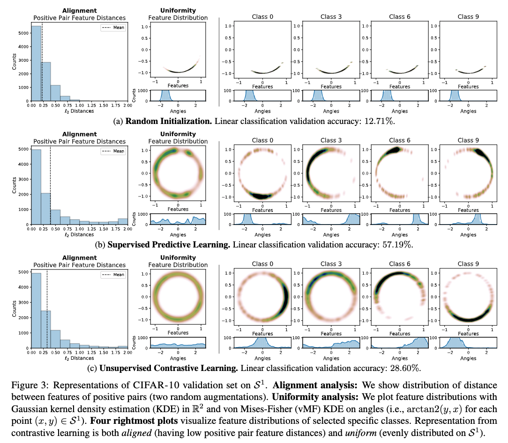

# Alignment and Uniformity

A good representation should be able to

- separate different instances, and
- cluster similar instances.

Wang et al proposed two concepts that matches the above two ideas, alignment and uniformity, on a hypersphere[^Wang2005].

> From Wang et al[^Wang2005].

[^Wang2005]: Wang T, Isola P. Understanding Contrastive Representation Learning through Alignment and Uniformity on the Hypersphere. arXiv [cs.LG]. 2020. Available: http://arxiv.org/abs/2005.10242
