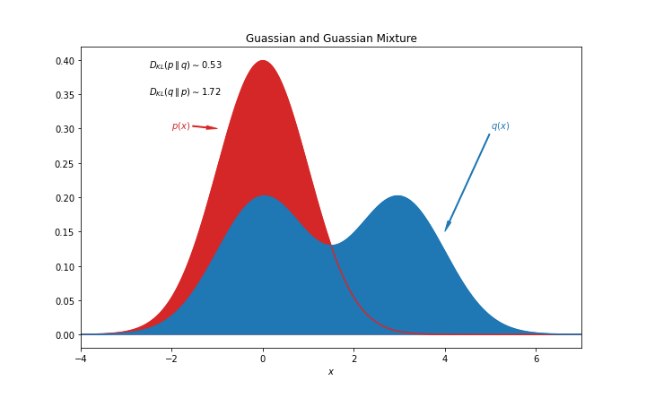

# KL Divergence

The Kullback–Leibler (KL) divergence is defined as

$$
\begin{align}
\operatorname{D}_\mathrm{KL}(p \parallel q ) =& \mathbb E_{p} \left[\log\left(\frac{p}{q}\right) \right] \\
=& \int_{-\infty}^\infty p \log\left(\frac{p}{q}\right)\, dx .
\end{align}
$$

Suppose $p$ is a Gaussian distribution and $q$ is a bimodal Gaussian mixture, the KL divergence $\operatorname{D}_\mathrm{KL}(p \parallel q )$ and $\operatorname{D}_\mathrm{KL}(q \parallel p )$ are different as KL divergence is not necessarily symmetric. Thus the KL divergence is not a proper distance definition.

KL divergence is a special case of [f-divergence](f-divergence.md).

## Try It: The Two Directions of the KL Divergence

As in the figure above, $p$ is a Gaussian and $q$ is a mixture with two modes. Move $p$, or the modes of $q$, and compare $\operatorname{D}_\mathrm{KL}(p \parallel q)$ with $\operatorname{D}_\mathrm{KL}(q \parallel p)$. The lower chart shows where each of the two integrals collects its value.

An interactive chart of a Gaussian $p$ and a two-mode mixture $q$, with sliders for the mean and spread of $p$ and for the modes of $q$. It shows both densities, the integrands $p \log(p/q)$ and $q \log(q/p)$, and the two KL divergences. It needs JavaScript. In short: the two directions give different values, for example about 0.69 against 7.5 nats when $p$ sits on one mode of $q$.

