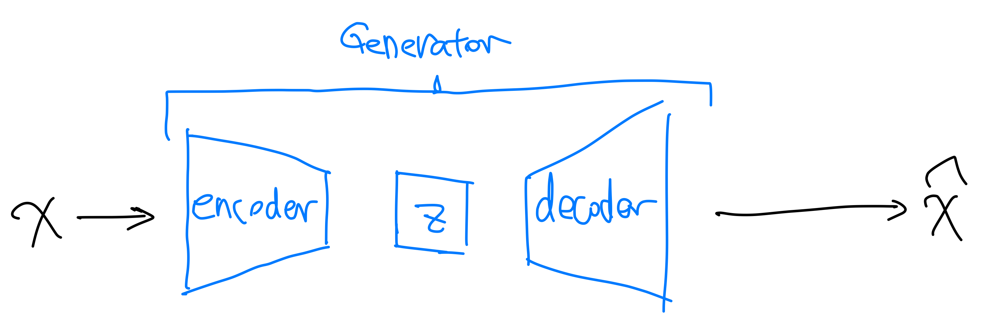

---
tags:
  - WIP
summary: >-
  The generative models in this part share three pieces: an encoder, an
  explicit latent space and a decoder.
related:
  - self-supervised/generative/ae.md
  - self-supervised/generative/vae.md
  - self-supervised/generative/flow.md
---

# Generative Models

Generative models come with

- an encoder,
- an explicit latent space, and
- a decoder.
