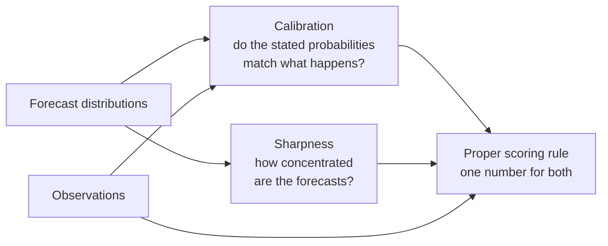

# Evaluating Probabilistic Forecasts

A point forecast says "tomorrow's demand is 120". A probabilistic forecast says "tomorrow's demand is between 100 and 145 with 90% probability", or gives the whole distribution. Checking the first against an observed 131 is a subtraction. Checking the second is harder: the forecast is a distribution, the observation is one number, and a single observation can neither confirm nor refute a probability.

This page follows the approach of Gneiting, Balabdaoui and Raftery: a good probabilistic forecast is as sharp as possible, subject to being calibrated[@Gneiting2007-cal]. Scoring rules then put both properties into one number[@Gneiting2007-spsr].

!!! info "How This Page Is Organized"

    Each of the four concepts is treated in the same five steps:

    1. **The idea**, in plain words.
    2. **The math**, with the definition from the original paper.
    3. **The picture**, a diagram of the definition.
    4. **Try it**, an interactive version of the picture with an animation.
    5. **Watch out**, the ways the concept gets misused.

    | Concept | Question it answers | Needs |
    | --- | --- | --- |
    | Calibration and sharpness | Can the stated probabilities be trusted, and are they informative? | the full distribution |
    | Proper scoring rules | Which single number may be used to rank forecasters? | depends on the rule |
    | Quantile loss | How good is one quoted quantile? | one quantile |
    | Interval score | How good is a quoted prediction interval? | two quantiles |

Throughout, $F_t$ is the forecast for time $t$ as a cumulative distribution function, $x_t$ is the observation, and scores are written so that **lower is better**.

## Calibration and Sharpness

**The idea.** If a forecaster's 90% intervals contain the observation 90% of the time, the 50% intervals half of the time, and so on for every level, the stated probabilities mean what they say. This is calibration. It is a joint property of the forecasts and the observations. Calibration is not enough: a forecaster who quotes the long-run distribution of the series every single day is calibrated and tells us nothing about tomorrow. Sharpness is how concentrated the forecast distributions are, and it is a property of the forecasts alone. The goal is to be as sharp as possible while staying calibrated[@Gneiting2007-cal].

**The math.** The probability integral transform, or PIT, is the value of the forecast distribution at the observation,

$$
p_t = F_t(x_t).
$$

It answers "how much of the forecast's probability was below what happened?". Suppose nature draws $x_t$ from a distribution $G_t$. If the forecast is ideal, $F_t = G_t$, and $F_t$ is continuous, then $p_t$ is uniformly distributed on $[0, 1]$. The reason is short: $P(F_t(x_t) \le p) = P(x_t \le F_t^{-1}(p)) = G_t(F_t^{-1}(p)) = p$ when $F_t = G_t$. Gneiting, Balabdaoui and Raftery call a sequence of forecasts probabilistically calibrated when this holds on average,

$$
\frac{1}{T} \sum_{t=1}^{T} G_t\left( F_t^{-1}(p) \right) \to p \qquad \text{for all } p \in (0, 1),
$$

and show that this is equivalent to the PIT values being uniform in the long run[@Gneiting2007-cal]. The $G_t$ are never observed, but the PIT values are, so the check can be done with data: collect $p_1, \cdots, p_T$ and look at their histogram.

The coverage of a central prediction interval can be read off the same histogram. The central 90% interval contains $x_t$ exactly when $0.05 \le p_t \le 0.95$, so its empirical coverage is the share of PIT values in that range.

For sharpness, the authors use the width of the prediction intervals, for example the average width of the central 50% and 90% intervals, or box plots of the widths when they vary a lot over time[@Gneiting2007-cal].

**The picture.** The shape of the PIT histogram says what is wrong with the forecasts[@Gneiting2007-cal].

| Histogram | Reading |
| --- | --- |
| Flat | Probabilistically calibrated |
| Hump in the middle | Forecast distributions too wide (overdispersed) |
| U shape | Forecast distributions too narrow |
| Triangle, sloping to one side | Forecasts biased |

**Try it.** In the widget, nature draws a state $\mu_t$ from $N(0, 1)$ and then the observation from $N(\mu_t, 1)$. "Your forecaster" sees $\mu_t$ and forecasts $N(\mu_t + \text{bias}, \text{spread}^2)$. Press Play to watch single forecasts turn into PIT values, then move the two sliders and match each row of the table above.

An interactive PIT histogram. A forecaster issues 4000 forecasts; for each, the forecast density is shown with the observation, the area to the left of the observation is the PIT value, and the PIT values are collected in a histogram with 20 bins. Sliders set the forecaster's bias and spread; the coverage of the 50% and 90% intervals, the average width of the 90% interval and the mean CRPS are shown. It needs JavaScript. In short: forecasts that are too wide give a hump, forecasts that are too narrow give a U shape, and biased forecasts give a slope.

**Watch out.** A flat PIT histogram is necessary for an ideal forecaster, not sufficient. The other four buttons of the widget reproduce the simulation in Gneiting, Balabdaoui and Raftery, built around an example by Hamill[@Gneiting2007-cal]:

| Forecaster | Forecast when nature uses $N(\mu_t, 1)$ |
| --- | --- |
| Ideal | $N(\mu_t, 1)$ |
| Climatological | $N(0, 2)$, the same every time |
| Unfocused | $\frac{1}{2}\left( N(\mu_t, 1) + N(\mu_t + \tau_t, 1) \right)$, with $\tau_t = \pm 1$ at random |
| Hamill's | $N(\mu_t + \delta_t, \sigma_t^2)$, with $(\delta_t, \sigma_t^2)$ one of $(\frac{1}{2}, 1)$, $(-\frac{1}{2}, 1)$, $(0, \frac{169}{100})$ at random |

All four have PIT histograms that are essentially flat, although three of them are clearly worse than the ideal forecaster, and for Hamill's forecaster none of the single forecasts is the distribution nature used. What separates them is sharpness: in the paper, the average width of the 90% interval is 3.29 for the ideal forecaster, 3.62 for Hamill's, 3.68 for the unfocused and 4.65 for the climatological forecaster, and the CRPS and the logarithmic score rank them in the same order[@Gneiting2007-cal]. The widget uses its own random draws, so its numbers differ from the paper's in the last digits.

Two more points from the same paper. For forecasts $k$ steps ahead, the PIT values of even an ideal forecaster are dependent over time, up to lag $k - 1$, which makes formal tests of uniformity delicate. And for ensemble forecasts, where the forecast is a set of sample paths and not a distribution function, the same check is done with the rank of the observation among the ensemble members, the verification rank histogram[@Gneiting2007-cal].

## Proper Scoring Rules

**The idea.** To rank forecasters we need one number. A scoring rule gives a penalty $S(F, x)$ to the forecast $F$ when $x$ is observed. Not every reasonable-looking penalty will do. If a forecaster can lower their expected penalty by reporting something other than what they believe, the score rewards gaming, and a model trained or selected with it learns to game. A proper scoring rule is one where honesty is the best policy.

**The math.** Write $S(F, G)$ for the expected penalty of the forecast $F$ when the observation is drawn from $G$,

$$
S(F, G) = \int S(F, x) \, \mathrm d G(x).
$$

The scoring rule is proper if

$$
S(G, G) \le S(F, G) \qquad \text{for all } F \text{ and } G,
$$

and strictly proper if equality holds only for $F = G$[@Gneiting2007-spsr]. Gneiting and Raftery state the definition for rewards, where larger is better; the inequality here is the same statement for penalties.

Three scores for a forecast with density $f$ and distribution function $F$ show the difference.

| Score | Penalty $S(F, x)$ | Proper? |
| --- | --- | --- |
| Logarithmic score | $-\log f(x)$ | strictly proper |
| CRPS | $\int_{-\infty}^{\infty} \left( F(y) - \mathbb 1\{ y \ge x \} \right)^2 \mathrm d y$ | strictly proper for distributions with a finite mean |
| Linear score | $-f(x)$ | not proper |

The linear score looks natural: reward the forecaster by the density they put on what happened. Gneiting and Raftery show that it is not proper and that it encourages putting too much mass on the mode of the forecaster's true belief[@Gneiting2007-spsr].

The CRPS has a second form that is often easier to compute and to interpret[@Gneiting2007-spsr],

$$
\operatorname{CRPS}(F, x) = \mathbb E_F \lvert X - x \rvert - \frac{1}{2} \mathbb E_F \lvert X - X' \rvert,
$$

where $X$ and $X'$ are independent draws from $F$. The first term is the expected distance from the forecast to the observation. The second term is half the expected distance between two draws from the forecast, a measure of its spread. It is in the unit of the observations, and for a point forecast the second term vanishes and the CRPS is the absolute error. The [CRPS page](timeseries-metrics.forecasting.crps.md) covers it in detail.

**The picture.** Take the simplest case: the observation comes from $N(0, 1)$ and the forecaster reports $N(m, s^2)$. The expected penalty is then a function of the report $(m, s)$, and for these three scores it has a closed form:

$$
\begin{aligned}
\text{Log score:} \quad & \log\left( s \sqrt{2\pi} \right) + \frac{1 + m^2}{2 s^2}, \\
\text{CRPS:} \quad & A\left(m, 1 + s^2\right) - \frac{s}{\sqrt{\pi}}, \\
\text{Linear score:} \quad & -\frac{1}{\sqrt{2\pi (1 + s^2)}} \exp\left( -\frac{m^2}{2(1 + s^2)} \right),
\end{aligned}
$$

where $A(\mu, \sigma^2) = \mu \left( 2\Phi(\mu / \sigma) - 1 \right) + 2 \sigma \varphi(\mu / \sigma)$ is the mean of $\lvert Z \rvert$ for $Z \sim N(\mu, \sigma^2)$, and $\varphi$ and $\Phi$ are the standard normal density and distribution function. These follow from the definitions by integrating over $x \sim N(0, 1)$. For a proper score, the surface has its lowest point at the honest report $m = 0$, $s = 1$. The widget draws a slice through each surface.

**Try it.** Press Play to sweep the reported spread from wide to narrow and watch the three markers. Then set a wrong mean and see where the lowest point of each curve moves.

An interactive chart. The true distribution is a standard normal and the forecaster reports a normal distribution with a chosen mean and spread. Three panels show the expected logarithmic score, CRPS and linear score as functions of the reported spread. It needs JavaScript. In short: with the right mean, the logarithmic score and the CRPS are lowest when the reported spread equals the true spread of 1, with expected values 1.419 and 0.564; the linear score keeps improving as the reported spread shrinks, so it rewards overconfidence.

**Watch out.**

- Being proper does not make two scores agree. The logarithmic score looks only at the density at the observation; the CRPS gives credit for probability placed near the observation. The logarithmic score is unbounded, so a single observation in a region where the forecast density is almost zero can dominate an average; Gneiting, Balabdaoui and Raftery describe it as lacking robustness and the CRPS as the more robust alternative[@Gneiting2007-cal].
- Scores of two forecasters are comparable only when they are computed on exactly the same set of forecast cases[@Gneiting2007-spsr].
- A skill score built from a proper score, as in [Baselines and Skill Scores](timeseries-evaluation.baselines.md), is in general not proper itself, even though it is convenient for reporting[@Gneiting2007-spsr].
- With a wrong mean, the lowest expected penalty is at a spread wider than the truth. A proper score does not ask for narrow forecasts; it asks for the forecaster's honest uncertainty, including the uncertainty about their own bias.

## Quantile Loss

**The idea.** Often the forecast is not a full distribution but a few quantiles: "there is a 90% chance that demand stays below 145". To score the quoted value $r$ for the quantile at level $\alpha$, penalize the distance to the observation, with different prices on the two sides. For $\alpha = 0.9$, an observation above $r$ should be rare, so each unit it lies above costs 0.9, while each unit an observation lies below costs only 0.1. The quoted value settles where the two kinds of pull balance, and that happens when a fraction $\alpha$ of the observations is below it.

**The math.** The quantile loss, also called pinball, tick or check loss, is

$$
\rho_\alpha(r, x) = (x - r)\left( \alpha - \mathbb 1\{ x \le r \} \right)
= \begin{cases}
\alpha \, (x - r), & x > r, \\
(1 - \alpha)(r - x), & x \le r.
\end{cases}
$$

Gneiting and Raftery prove that it is a proper scoring rule for the quantile at level $\alpha$: the expected loss is smallest when $r$ is the true $\alpha$-quantile[@Gneiting2007-spsr]. This is one term of the quantile loss in [Time Series Forecasting Metrics](timeseries-metrics.forecasting.md#quantile-loss), which sums over time steps and quantile levels.

The balance argument can be made exact. Where the expected loss is differentiable in $r$, its derivative is

$$
\frac{\mathrm d}{\mathrm d r} \mathbb E \, \rho_\alpha(r, X) = (1 - \alpha) P(X \le r) - \alpha P(X > r) = P(X \le r) - \alpha,
$$

which is zero exactly when $P(X \le r) = \alpha$. For $\alpha = \frac{1}{2}$ the loss is half the absolute error, and the best $r$ is the median.

**The picture.** As a function of the observation, the loss is a V with its corner at $r$ and unequal slopes: $1 - \alpha$ on the left and $\alpha$ on the right. In the widget's upper panel, each observation has a bar whose height is its loss. The lower panel shows the average of the bars for every possible $r$.

**Try it.** Pick a level, then press "Let it settle": every observation above $r$ pulls it up with weight $\alpha$, every one below pulls it down with weight $1 - \alpha$, and $r$ moves until the pulls balance.

An interactive chart of the pinball loss on 15 observations. Sliders set the level and the quoted quantile; the upper panel shows the loss of each observation and the lower panel the average loss for every possible quoted value. It needs JavaScript. In short: the average loss is lowest when the share of observations at or below the quoted value equals the level, so the minimizer is the sample quantile.

**Watch out.**

- One quantile says nothing about the rest of the distribution. Two forecasters with the same 90% quantile can disagree completely about the median.
- The loss is in the unit of the data, so averages across series on different scales are dominated by the large ones, the same problem as for the MAE.
- A full distribution can be scored by combining the quantile losses of all levels: integrating a proper quantile score over the levels gives a proper score for the distribution[@Gneiting2007-spsr].

## Interval Score

**The idea.** A prediction interval is good when it is narrow and still catches the observation. Width alone rewards intervals that are too narrow, coverage alone rewards intervals that are too wide. The interval score charges for both: the width of the interval, plus a penalty for every observation outside it, in proportion to how far outside it lies. The rarer misses are supposed to be, the higher the price of a miss.

**The math.** For the central $(1 - \alpha) \times 100\%$ prediction interval $[l, u]$, where $l$ and $u$ are the quoted quantiles at levels $\frac{\alpha}{2}$ and $1 - \frac{\alpha}{2}$, the interval score is[@Gneiting2007-spsr]

$$
S_\alpha^{\text{int}}(l, u; x) = (u - l) + \frac{2}{\alpha} (l - x) \, \mathbb 1\{ x < l \} + \frac{2}{\alpha} (x - u) \, \mathbb 1\{ x > u \}.
$$

For a 90% interval $\alpha = 0.1$, so a miss costs 20 times its distance to the interval. The score is not a new invention on top of the quantile loss: it is the sum of the quantile losses of the two endpoints, multiplied by $\frac{2}{\alpha}$,

$$
S_\alpha^{\text{int}}(l, u; x) = \frac{2}{\alpha} \left( \rho_{\alpha/2}(l, x) + \rho_{1 - \alpha/2}(u, x) \right),
$$

which can be checked case by case for $x < l$, $l \le x \le u$ and $x > u$. It is therefore proper: the expected score is lowest when $l$ and $u$ are the true quantiles[@Gneiting2007-spsr].

**The picture.** The widget shows the true distribution $N(0, 1)$, the quoted interval as a band, and observations below. An observation that misses is joined to the endpoint it missed; that length, times $\frac{2}{\alpha}$, is its penalty. The two bars compare the expected score of the quoted interval, split into width and penalties, with that of the true quantiles.

**Try it.** Press Play to let observations arrive one at a time. Then try the four examples, in particular "One-sided".

An interactive chart of a prediction interval against observations from a standard normal distribution. Sliders set the lower and upper end of the interval and buttons set the nominal coverage. The expected interval score is shown as the width plus the penalties for misses, next to the score of the true quantiles. It needs JavaScript. In short: for a 90% interval the true quantiles are ±1.64 with an expected score of 4.13; narrower intervals pay more in penalties than they save in width, wider intervals pay more in width than they save in penalties, and an interval with the right coverage in the wrong place also scores worse.

**Watch out.** Coverage alone can not rank interval forecasts. Gneiting and Raftery compare three ways of forming 95% intervals for a simulated time series whose variance depends on its current value: the true conditional quantiles, the quantiles of the long-run distribution, and an interval built to be as short as possible at the nominal coverage. All three have close to 95% coverage over 100,000 forecasts. Their average widths are 4.00, 5.45 and 3.79, and their average interval scores are 4.77, 8.04 and 5.32. The shortest interval is not the best one: it becomes narrowest when the conditional variance is highest. Only the score identifies the true conditional quantiles as the best forecast[@Gneiting2007-spsr].

The "One-sided" example in the widget shows a smaller version of the same effect: an interval from the 10% quantile upwards has 90% coverage too, and a worse score than the central one.

## In Practice

A probabilistic evaluation that covers the points on this page reports

1. a proper score, averaged over the same forecast cases for every method, with a baseline next to it (see [Baselines and Skill Scores](timeseries-evaluation.baselines.md));
2. the PIT histogram, or the coverage of a few central intervals, to see whether the probabilities can be trusted;
3. the interval widths, to see how informative the forecasts are;
4. which score was used for which kind of forecast: the CRPS or the logarithmic score for full distributions, the quantile loss for quantiles, the interval score for intervals.

A single score ranks the methods. The calibration and sharpness diagnostics explain the ranking and show what to fix.
