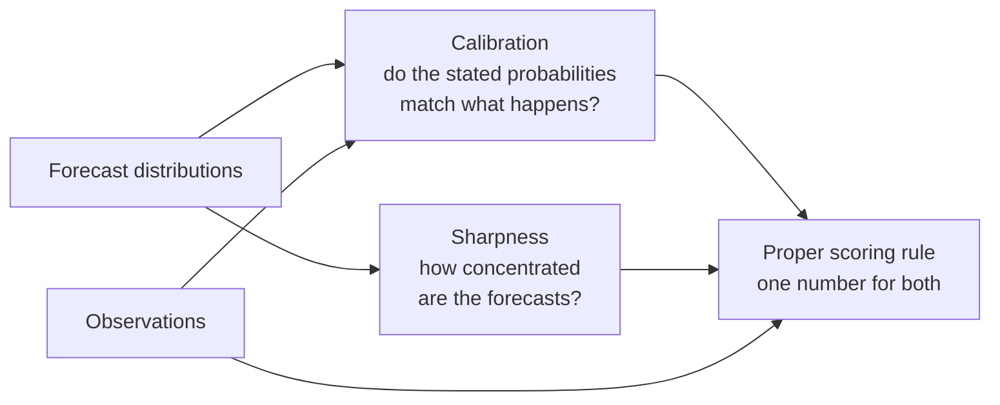

# Evaluating Probabilistic Forecasts

A point forecast says "tomorrow's demand is 120". A probabilistic forecast says "tomorrow's demand is between 100 and 145 with 90% probability", or gives the whole distribution. Checking the first against an observed 131 is a subtraction. Checking the second is harder: the forecast is a distribution, the observation is one number, and a single observation can neither confirm nor refute a probability.

This page follows the approach of Gneiting, Balabdaoui and Raftery: a good probabilistic forecast is as sharp as possible, subject to being calibrated[@Gneiting2007-cal]. Scoring rules then put both properties into one number[@Gneiting2007-spsr].

!!! info "How This Page Is Organized"

    Each of the four concepts is treated in the same five steps:

    1. **The idea**, in plain words.
    2. **The math**, with the definition from the original paper.
    3. **The picture**, a diagram of the definition.
    4. **Try it**, an interactive version of the picture with an animation.
    5. **Watch out**, the ways the concept gets misused.

    | Concept | Question it answers | Needs |
    | --- | --- | --- |
    | Calibration and sharpness | Can the stated probabilities be trusted, and are they informative? | the full distribution |
    | Proper scoring rules | Which single number may be used to rank forecasters? | depends on the rule |
    | Quantile loss | How good is one quoted quantile? | one quantile |
    | Interval score | How good is a quoted prediction interval? | two quantiles |
    | The CRPS family | How do these scores relate, and what do deep learning papers report? | quantiles, samples or a distribution |
    | Multivariate scores | How good is a joint forecast of many series? | samples of whole vectors |
    | Conformal prediction | Can coverage be guaranteed after the model is trained? | any forecaster and held-out data |

## Four Questions, Three Formats

Read together, the papers behind this page answer four questions in a fixed order. Each question has its own tools and its own typical failure. The table is this page's arrangement of the literature.

| Question | Tools | Typical failure |
| --- | --- | --- |
| What was the forecaster asked to report? | consistent scoring functions, elicitability[@Gneiting2011-point] | scoring a mean with a score that rewards the median[@Gneiting2011-point]; asking for a summary that no score can reward on its own, such as the variance[@Fissler2015-elicit] |
| Can the stated probabilities be trusted? | PIT histogram or probability plot, rank histogram, reliability diagram, coverage | conclusions that depend on the bins[@Dimitriadis2020-corp]; coverage on average read as coverage in every situation[@Angelopoulos2021-conformal] |
| Given that, how informative is the forecast? | interval width, variance | sharp and miscalibrated quantile networks[@Chung2020-beyond]; valid intervals of constant width[@Romano2019-cqr] |
| Which forecaster is better, and is the difference real? | proper scoring rules and their sampling variation | hidden weights in an average[@Bolin2019-scale]; evaluating only the extreme outcomes[@Lerch2015-dilemma]; too few evaluation windows[@Marcotte2023-regions] |

The format in which a model delivers its forecast decides which tools are available.

| Forecast format | Calibration check | Score |
| --- | --- | --- |
| a density or distribution function | PIT | logarithmic score, CRPS in closed form |
| samples, as from most deep models | rank histogram, PIT of the empirical distribution | CRPS and energy score estimated from the samples[@Jordan2017-scoringrules]; the logarithmic score needs a density estimate and is fragile[@Jordan2017-scoringrules] |
| a set of quantiles | coverage per level; exact PIT values can not be computed[@Bracher2020-wis] | quantile loss, weighted interval score |

Throughout, $F_t$ is the forecast for time $t$ as a cumulative distribution function, $x_t$ is the observation, and scores are written so that **lower is better**.

## Calibration and Sharpness

**The idea.** If a forecaster's 90% intervals contain the observation 90% of the time, the 50% intervals half of the time, and so on for every level, the stated probabilities mean what they say. This is calibration. It is a joint property of the forecasts and the observations. Calibration is not enough: a forecaster who quotes the long-run distribution of the series every single day is calibrated and tells us nothing about tomorrow. Sharpness is how concentrated the forecast distributions are, and it is a property of the forecasts alone. The goal is to be as sharp as possible while staying calibrated[@Gneiting2007-cal].

**The math.** The probability integral transform, or PIT, is the value of the forecast distribution at the observation,

$$
p_t = F_t(x_t).
$$

It answers "how much of the forecast's probability was below what happened?". Suppose nature draws $x_t$ from a distribution $G_t$. If the forecast is ideal, $F_t = G_t$, and $F_t$ is continuous, then $p_t$ is uniformly distributed on $[0, 1]$. The reason is short: $P(F_t(x_t) \le p) = P(x_t \le F_t^{-1}(p)) = G_t(F_t^{-1}(p)) = p$ when $F_t = G_t$. Gneiting, Balabdaoui and Raftery call a sequence of forecasts probabilistically calibrated when this holds on average,

$$
\frac{1}{T} \sum_{t=1}^{T} G_t\left( F_t^{-1}(p) \right) \to p \qquad \text{for all } p \in (0, 1),
$$

and show that this is equivalent to the PIT values being uniform in the long run[@Gneiting2007-cal]. The $G_t$ are never observed, but the PIT values are, so the check can be done with data: collect $p_1, \cdots, p_T$ and look at their histogram.

The coverage of a central prediction interval can be read off the same histogram. The central 90% interval contains $x_t$ exactly when $0.05 \le p_t \le 0.95$, so its empirical coverage is the share of PIT values in that range.

For time series there is a second requirement. Diebold, Gunther and Tay show that when one-step density forecasts equal the true conditional densities, the PIT values are not only uniform but also independent over time[@Diebold1997-density]. They recommend looking at two pictures: the histogram of the PIT values for uniformity, and their correlogram for independence.

"Calibrated" has several meanings in the literature, and they form a ladder. Gneiting and Resin order them[@Gneiting2021-regdiag]:

| Notion | Condition | Checked by |
| --- | --- | --- |
| Auto-calibration | given the issued distribution, the outcome behaves like a draw from it | the strongest notion; implies the two below |
| Probabilistic calibration | the PIT is uniform | PIT histogram; implies nominal coverage of central intervals |
| Marginal calibration | the average forecast distribution equals the distribution of the outcomes | comparing the two averages |

Probabilistic and marginal calibration do not imply each other. The machine learning literature uses other names for rungs of the same ladder. Kuleshov, Fenner and Ermon call a regression forecaster calibrated when[@Kuleshov2018-cal]

$$
\frac{1}{T} \sum_{t=1}^{T} \mathbb 1\left\{ y_t \le F_t^{-1}(p) \right\} \to p \qquad \text{for all } p \in [0, 1],
$$

which is coverage of every quantile on average. Chung and coauthors call this average calibration and separate it from individual calibration, where the quantiles are right for every input, and which can not be verified from finite data without assumptions[@Chung2020-beyond]. For classifiers, Guo and coauthors measure the gap between confidence and accuracy over bins, the expected calibration error, and report that modern neural networks are poorly calibrated[@Guo2017-cal].

For sharpness, the authors use the width of the prediction intervals, for example the average width of the central 50% and 90% intervals, or box plots of the widths when they vary a lot over time[@Gneiting2007-cal].

**The picture.** The shape of the PIT histogram says what is wrong with the forecasts[@Gneiting2007-cal].

| Histogram | Reading |
| --- | --- |
| Flat | Probabilistically calibrated |
| Hump in the middle | Forecast distributions too wide (overdispersed) |
| U shape | Forecast distributions too narrow |
| Triangle, sloping to one side | Forecasts biased |

**Try it.** In the widget, nature draws a state $\mu_t$ from $N(0, 1)$ and then the observation from $N(\mu_t, 1)$. "Your forecaster" sees $\mu_t$ and forecasts $N(\mu_t + \text{bias}, \text{spread}^2)$. Press Play to watch single forecasts turn into PIT values, then move the two sliders and match each row of the table above.

An interactive PIT histogram. A forecaster issues 4000 forecasts; for each, the forecast density is shown with the observation, the area to the left of the observation is the PIT value, and the PIT values are collected in a histogram with 20 bins. Sliders set the forecaster's bias and spread; the coverage of the 50% and 90% intervals, the average width of the 90% interval and the mean CRPS are shown. It needs JavaScript. In short: forecasts that are too wide give a hump, forecasts that are too narrow give a U shape, and biased forecasts give a slope.

**Watch out.** A flat PIT histogram is necessary for an ideal forecaster, not sufficient. The other four buttons of the widget reproduce the simulation in Gneiting, Balabdaoui and Raftery, built around an example by Hamill[@Gneiting2007-cal]:

| Forecaster | Forecast when nature uses $N(\mu_t, 1)$ |
| --- | --- |
| Ideal | $N(\mu_t, 1)$ |
| Climatological | $N(0, 2)$, the same every time |
| Unfocused | $\frac{1}{2}\left( N(\mu_t, 1) + N(\mu_t + \tau_t, 1) \right)$, with $\tau_t = \pm 1$ at random |
| Hamill's | $N(\mu_t + \delta_t, \sigma_t^2)$, with $(\delta_t, \sigma_t^2)$ one of $(\frac{1}{2}, 1)$, $(-\frac{1}{2}, 1)$, $(0, \frac{169}{100})$ at random |

All four have PIT histograms that are essentially flat, although three of them are clearly worse than the ideal forecaster, and for Hamill's forecaster none of the single forecasts is the distribution nature used. What separates them is sharpness: in the paper, the average width of the 90% interval is 3.29 for the ideal forecaster, 3.62 for Hamill's, 3.68 for the unfocused and 4.65 for the climatological forecaster, and the CRPS and the logarithmic score rank them in the same order[@Gneiting2007-cal]. The widget uses its own random draws, so its numbers differ from the paper's in the last digits.

Further points from the wider literature:

- Histograms depend on their bins. Laio and Tamea plot the sorted PIT values against their ranks instead, which needs no binning; calibrated forecasts lie on the diagonal, and confidence bands can be drawn around it[@Laio2007-verif]. For binary events, Dimitriadis, Gneiting and Jordan show that reliability diagrams with 9, 10 and 11 bins of the same forecasts look drastically different, and replace the binning by isotonic regression[@Dimitriadis2020-corp].
- Calibration can be repaired after training. Kuleshov and coauthors fit a monotone map to the empirical distribution of the PIT values on held-out data and compose it with the forecast[@Kuleshov2018-cal]. The repair fixes the probabilities and not the sharpness: applied to a point forecaster it gives intervals of the same width everywhere.
- A forecast can pass every calibration check and have no operational value[@Laio2007-verif], which is the simulation above in one sentence. Calibration checks go together with a score.

Two more points from Gneiting, Balabdaoui and Raftery. For forecasts $k$ steps ahead, the PIT values of even an ideal forecaster are dependent over time, up to lag $k - 1$, which makes formal tests of uniformity delicate. And for ensemble forecasts, where the forecast is a set of sample paths and not a distribution function, the same check is done with the rank of the observation among the ensemble members, the verification rank histogram[@Gneiting2007-cal].

## Proper Scoring Rules

**The idea.** To rank forecasters we need one number. A scoring rule gives a penalty $S(F, x)$ to the forecast $F$ when $x$ is observed. Not every reasonable-looking penalty will do. If a forecaster can lower their expected penalty by reporting something other than what they believe, the score rewards gaming, and a model trained or selected with it learns to game. A proper scoring rule is one where honesty is the best policy.

**The math.** Write $S(F, G)$ for the expected penalty of the forecast $F$ when the observation is drawn from $G$,

$$
S(F, G) = \int S(F, x) \, \mathrm d G(x).
$$

The scoring rule is proper if

$$
S(G, G) \le S(F, G) \qquad \text{for all } F \text{ and } G,
$$

and strictly proper if equality holds only for $F = G$[@Gneiting2007-spsr]. Gneiting and Raftery state the definition for rewards, where larger is better; the inequality here is the same statement for penalties.

Three scores for a forecast with density $f$ and distribution function $F$ show the difference.

| Score | Penalty $S(F, x)$ | Proper? |
| --- | --- | --- |
| Logarithmic score | $-\log f(x)$ | strictly proper |
| CRPS | $\int_{-\infty}^{\infty} \left( F(y) - \mathbb 1\{ y \ge x \} \right)^2 \mathrm d y$ | strictly proper for distributions with a finite mean |
| Linear score | $-f(x)$ | not proper |

The linear score looks natural: reward the forecaster by the density they put on what happened. Gneiting and Raftery show that it is not proper and that it encourages putting too much mass on the mode of the forecaster's true belief[@Gneiting2007-spsr].

The CRPS has a second form that is often easier to compute and to interpret[@Gneiting2007-spsr],

$$
\operatorname{CRPS}(F, x) = \mathbb E_F \lvert X - x \rvert - \frac{1}{2} \mathbb E_F \lvert X - X' \rvert,
$$

where $X$ and $X'$ are independent draws from $F$. The first term is the expected distance from the forecast to the observation. The second term is half the expected distance between two draws from the forecast, a measure of its spread. It is in the unit of the observations, and for a point forecast the second term vanishes and the CRPS is the absolute error. The [CRPS page](timeseries-metrics.forecasting.crps.md) covers it in detail.

**The picture.** Take the simplest case: the observation comes from $N(0, 1)$ and the forecaster reports $N(m, s^2)$. The expected penalty is then a function of the report $(m, s)$, and for these three scores it has a closed form:

$$
\begin{aligned}
\text{Log score:} \quad & \log\left( s \sqrt{2\pi} \right) + \frac{1 + m^2}{2 s^2}, \\
\text{CRPS:} \quad & A\left(m, 1 + s^2\right) - \frac{s}{\sqrt{\pi}}, \\
\text{Linear score:} \quad & -\frac{1}{\sqrt{2\pi (1 + s^2)}} \exp\left( -\frac{m^2}{2(1 + s^2)} \right),
\end{aligned}
$$

where $A(\mu, \sigma^2) = \mu \left( 2\Phi(\mu / \sigma) - 1 \right) + 2 \sigma \varphi(\mu / \sigma)$ is the mean of $\lvert Z \rvert$ for $Z \sim N(\mu, \sigma^2)$, and $\varphi$ and $\Phi$ are the standard normal density and distribution function. These follow from the definitions by integrating over $x \sim N(0, 1)$. For a proper score, the surface has its lowest point at the honest report $m = 0$, $s = 1$. The widget draws a slice through each surface.

**Try it.** Press Play to sweep the reported spread from wide to narrow and watch the three markers. Then set a wrong mean and see where the lowest point of each curve moves.

An interactive chart. The true distribution is a standard normal and the forecaster reports a normal distribution with a chosen mean and spread. Three panels show the expected logarithmic score, CRPS and linear score as functions of the reported spread. It needs JavaScript. In short: with the right mean, the logarithmic score and the CRPS are lowest when the reported spread equals the true spread of 1, with expected values 1.419 and 0.564; the linear score keeps improving as the reported spread shrinks, so it rewards overconfidence.

**Watch out.**

- There is no ranking of wrong forecasts that everybody agrees with. Diebold, Gunther and Tay give two users with different loss functions and two imperfect density forecasts, and each user prefers a different one; only the correct density is preferred by all[@Diebold1997-density]. A scoring rule is a choice of user.
- Evaluating only the extreme cases breaks propriety. Restricting the test set to the occasions where something extreme happened is the same as multiplying the score by a weight on the outcome, and Gneiting and Ranjan prove that this makes any proper score improper[@Gneiting2008-weighted]. Lerch and coauthors call it the forecaster's dilemma: if evaluation is conditional on a catastrophe having been observed, always predicting calamity becomes a worthwhile strategy[@Lerch2015-dilemma]. Weighting by threshold or by quantile level, inside the score, keeps it proper; see the CRPS family below.
- Well-meant modifications can break propriety too. Cutting off the logarithmic score at a lower bound, to tame its infinities, makes it improper[@Bracher2020-wis].
- Propriety is a statement about expectations. It says nothing about how many observations are needed before the better forecaster actually gets the better score[@Marcotte2023-regions]; see [Is the Difference Real?](timeseries-evaluation.significance.md).
- Being proper does not make two scores agree. The logarithmic score looks only at the density at the observation; the CRPS gives credit for probability placed near the observation. The logarithmic score is unbounded, so a single observation in a region where the forecast density is almost zero can dominate an average; Gneiting, Balabdaoui and Raftery describe it as lacking robustness and the CRPS as the more robust alternative[@Gneiting2007-cal].
- Scores of two forecasters are comparable only when they are computed on exactly the same set of forecast cases[@Gneiting2007-spsr].
- A skill score built from a proper score, as in [Baselines and Skill Scores](timeseries-evaluation.baselines.md), is in general not proper itself, even though it is convenient for reporting[@Gneiting2007-spsr].
- With a wrong mean, the lowest expected penalty is at a spread wider than the truth. A proper score does not ask for narrow forecasts; it asks for the forecaster's honest uncertainty, including the uncertainty about their own bias.

## Quantile Loss

**The idea.** Often the forecast is not a full distribution but a few quantiles: "there is a 90% chance that demand stays below 145". To score the quoted value $r$ for the quantile at level $\alpha$, penalize the distance to the observation, with different prices on the two sides. For $\alpha = 0.9$, an observation above $r$ should be rare, so each unit it lies above costs 0.9, while each unit an observation lies below costs only 0.1. The quoted value settles where the two kinds of pull balance, and that happens when a fraction $\alpha$ of the observations is below it.

**The math.** The quantile loss, also called pinball, tick or check loss, is

$$
\rho_\alpha(r, x) = (x - r)\left( \alpha - \mathbb 1\{ x \le r \} \right)
= \begin{cases}
\alpha \, (x - r), & x > r, \\
(1 - \alpha)(r - x), & x \le r.
\end{cases}
$$

Gneiting and Raftery prove that it is a proper scoring rule for the quantile at level $\alpha$: the expected loss is smallest when $r$ is the true $\alpha$-quantile[@Gneiting2007-spsr]. This is one term of the quantile loss in [Time Series Forecasting Metrics](timeseries-metrics.forecasting.md#quantile-loss), which sums over time steps and quantile levels.

The loss also has a decision-theoretic reading. Laio and Tamea start from a user who pays a cost for acting and a larger loss for failing to act, with cost-loss ratio $\xi$. The expected expense is a pinball loss, and the best decision is the quantile at level $1 - \xi$ of the forecast distribution[@Laio2007-verif]. Each quantile level is the right answer for one kind of user. And the pinball loss is not the only loss with this property: Gneiting shows that a scoring function rewards the $\alpha$-quantile exactly when it has the form $(\mathbb 1\{x \ge y\} - \alpha)(g(x) - g(y))$ for a nondecreasing function $g$[@Gneiting2011-point].

The balance argument can be made exact. Where the expected loss is differentiable in $r$, its derivative is

$$
\frac{\mathrm d}{\mathrm d r} \mathbb E \, \rho_\alpha(r, X) = (1 - \alpha) P(X \le r) - \alpha P(X > r) = P(X \le r) - \alpha,
$$

which is zero exactly when $P(X \le r) = \alpha$. For $\alpha = \frac{1}{2}$ the loss is half the absolute error, and the best $r$ is the median.

**The picture.** As a function of the observation, the loss is a V with its corner at $r$ and unequal slopes: $1 - \alpha$ on the left and $\alpha$ on the right. In the widget's upper panel, each observation has a bar whose height is its loss. The lower panel shows the average of the bars for every possible $r$.

**Try it.** Pick a level, then press "Let it settle": every observation above $r$ pulls it up with weight $\alpha$, every one below pulls it down with weight $1 - \alpha$, and $r$ moves until the pulls balance.

An interactive chart of the pinball loss on 15 observations. Sliders set the level and the quoted quantile; the upper panel shows the loss of each observation and the lower panel the average loss for every possible quoted value. It needs JavaScript. In short: the average loss is lowest when the share of observations at or below the quoted value equals the level, so the minimizer is the sample quantile.

**Watch out.**

- One quantile says nothing about the rest of the distribution. Two forecasters with the same 90% quantile can disagree completely about the median.
- The loss is in the unit of the data, so averages across series on different scales are dominated by the large ones, the same problem as for the MAE.
- Quantiles estimated separately for each level can cross, a 90% quantile below an 80% one. Park and coauthors report the share of crossings as a metric of its own[@Park2021-quantile].
- A good evaluation loss is not automatically a good training loss. Chung and coauthors show a flexible network trained on the pinball loss that ends up sharper than the truth and miscalibrated, because the loss trades calibration against sharpness in a fixed way[@Chung2020-beyond]. An early deep forecasting paper already reported the quantile loss together with calibration and sharpness for this reason[@Wen2017-mqrnn].
- A full distribution can be scored by combining the quantile losses of all levels: integrating a proper quantile score over the levels gives a proper score for the distribution[@Gneiting2007-spsr]. This is the subject of [the CRPS family](#the-crps-family-one-score-in-many-cuts) below.

## Interval Score

**The idea.** A prediction interval is good when it is narrow and still catches the observation. Width alone rewards intervals that are too narrow, coverage alone rewards intervals that are too wide. The interval score charges for both: the width of the interval, plus a penalty for every observation outside it, in proportion to how far outside it lies. The rarer misses are supposed to be, the higher the price of a miss.

**The math.** For the central $(1 - \alpha) \times 100\%$ prediction interval $[l, u]$, where $l$ and $u$ are the quoted quantiles at levels $\frac{\alpha}{2}$ and $1 - \frac{\alpha}{2}$, the interval score is[@Gneiting2007-spsr]

$$
S_\alpha^{\text{int}}(l, u; x) = (u - l) + \frac{2}{\alpha} (l - x) \, \mathbb 1\{ x < l \} + \frac{2}{\alpha} (x - u) \, \mathbb 1\{ x > u \}.
$$

For a 90% interval $\alpha = 0.1$, so a miss costs 20 times its distance to the interval. The score is not a new invention on top of the quantile loss: it is the sum of the quantile losses of the two endpoints, multiplied by $\frac{2}{\alpha}$,

$$
S_\alpha^{\text{int}}(l, u; x) = \frac{2}{\alpha} \left( \rho_{\alpha/2}(l, x) + \rho_{1 - \alpha/2}(u, x) \right),
$$

which can be checked case by case for $x < l$, $l \le x \le u$ and $x > u$. It is therefore proper: the expected score is lowest when $l$ and $u$ are the true quantiles[@Gneiting2007-spsr].

Forecasts are often published as a median $m$ and several central intervals. Bracher and coauthors combine their interval scores into the weighted interval score[@Bracher2020-wis],

$$
\operatorname{WIS}_{\alpha_{0:K}}(F, y) = \frac{1}{K + \frac{1}{2}} \left( w_0 \lvert y - m \rvert + \sum_{k=1}^{K} w_k \, S_{\alpha_k}^{\text{int}}(l_k, u_k; y) \right),
$$

with $w_0 = \frac{1}{2}$ and $w_k = \frac{\alpha_k}{2}$. With these weights it equals the average pinball loss over all the quantiles involved, up to the factor 2 of the previous identity, and it approaches the CRPS as the number of intervals grows. Like the interval score it splits into a width part and penalties for over- and underprediction, which makes it possible to show why a forecaster scored badly.

**The picture.** The widget shows the true distribution $N(0, 1)$, the quoted interval as a band, and observations below. An observation that misses is joined to the endpoint it missed; that length, times $\frac{2}{\alpha}$, is its penalty. The two bars compare the expected score of the quoted interval, split into width and penalties, with that of the true quantiles.

**Try it.** Press Play to let observations arrive one at a time. Then try the four examples, in particular "One-sided".

An interactive chart of a prediction interval against observations from a standard normal distribution. Sliders set the lower and upper end of the interval and buttons set the nominal coverage. The expected interval score is shown as the width plus the penalties for misses, next to the score of the true quantiles. It needs JavaScript. In short: for a 90% interval the true quantiles are ±1.64 with an expected score of 4.13; narrower intervals pay more in penalties than they save in width, wider intervals pay more in width than they save in penalties, and an interval with the right coverage in the wrong place also scores worse.

**Watch out.** Coverage alone can not rank interval forecasts. Gneiting and Raftery compare three ways of forming 95% intervals for a simulated time series whose variance depends on its current value: the true conditional quantiles, the quantiles of the long-run distribution, and an interval built to be as short as possible at the nominal coverage. All three have close to 95% coverage over 100,000 forecasts. Their average widths are 4.00, 5.45 and 3.79, and their average interval scores are 4.77, 8.04 and 5.32. The shortest interval is not the best one: it becomes narrowest when the conditional variance is highest. Only the score identifies the true conditional quantiles as the best forecast[@Gneiting2007-spsr].

The "One-sided" example in the widget shows a smaller version of the same effect: an interval from the 10% quantile upwards has 90% coverage too, and a worse score than the central one.

## The CRPS Family: One Score in Many Cuts

**The idea.** The scores so far look like separate tools. They are one object seen from different sides. The CRPS of a forecast is the average of its quantile losses over all levels, and equally the average of the squared errors of its probability forecasts over all thresholds. Take one level and it is the quantile loss; take two and it is the interval score; take nine and it is the number that many deep learning papers print in their tables, often under the name CRPS.

**The math.** Gneiting and Ranjan write the two representations side by side[@Gneiting2008-weighted]. With this page's quantile loss $\rho_\alpha$,

$$
\operatorname{CRPS}(F, y) = \int_{-\infty}^{\infty} \left( F(z) - \mathbb 1\{ y \le z \} \right)^2 \mathrm d z = 2 \int_0^1 \rho_\alpha\left( F^{-1}(\alpha), y \right) \mathrm d \alpha .
$$

The first integrand is the Brier score of the forecast probability that the outcome stays below the threshold $z$. The second representation is credited to Laio and Tamea, who derived it by averaging the expense of the cost-loss user of the previous section over all cost-loss ratios: the CRPS is the score of a user with no particular ratio[@Laio2007-verif].

| Cut of the family | Score | Used by |
| --- | --- | --- |
| one threshold | Brier score | forecasts of a binary event |
| one level | quantile (pinball) loss | quantile forecasts |
| two levels | interval score[@Gneiting2007-spsr] | prediction intervals |
| a grid of levels | weighted interval score[@Bracher2020-wis]; weighted quantile loss[@Park2021-quantile] | forecast hubs; deep forecasting papers |
| a weight on thresholds or levels | threshold- and quantile-weighted CRPS[@Gneiting2008-weighted] | emphasis on tails or on the centre |
| a vector norm in place of the absolute value | energy score[@Gneiting2008-multi] | joint forecasts of several series |

Two formulas matter in practice. When the forecast is a sample $X_1, \cdots, X_m$, as from most deep models, the CRPS of its empirical distribution is[@Jordan2017-scoringrules]

$$
\operatorname{CRPS}(\hat F_m, y) = \frac{1}{m} \sum_{i=1}^{m} \lvert X_i - y \rvert - \frac{1}{2 m^2} \sum_{i=1}^{m} \sum_{j=1}^{m} \lvert X_i - X_j \rvert .
$$

And the weighted quantile loss of the deep forecasting literature, for series $i$, time steps $t$ and quantile forecasts $q_{i,t}(\alpha)$, is[@Park2021-quantile]

$$
\operatorname{wQL}[\alpha] = 2 \, \frac{\sum_{i,t} \rho_\alpha\left( q_{i,t}(\alpha), z_{i,t} \right)}{\sum_{i,t} \lvert z_{i,t} \rvert},
$$

averaged over a grid of levels, commonly $0.1, 0.2, \cdots, 0.9$[@Ansari2024-chronos].

To put the emphasis on part of the distribution without breaking propriety, the weight goes inside the integral, on the thresholds or on the levels[@Gneiting2008-weighted]:

$$
\int_{-\infty}^{\infty} \left( F(z) - \mathbb 1\{ y \le z \} \right)^2 u(z) \, \mathrm d z, \qquad 2 \int_0^1 \rho_\alpha\left( F^{-1}(\alpha), y \right) v(\alpha) \, \mathrm d \alpha .
$$

A weight $u(z) = \mathbb 1\{ z \ge r \}$ looks only at the right tail, and stays proper, unlike a test set restricted to large outcomes[@Lerch2015-dilemma].

**The picture.** The widget plots twice the quantile loss of a normal forecast at every level, against one observation. The area under the curve, which is its mean height, is the CRPS. The orange stems are the levels a quantile forecast would report.

**Try it.** Press Play to raise the number of levels from 1 to 99 and watch the grid average approach the exact CRPS. Then move the forecast away from the observation, or make it very narrow, and compare the nine-level value with the exact one.

An interactive chart of twice the pinball loss of a normal forecast's quantile at every level, against the observation 0. The mean height of the curve is the CRPS. Sliders set the forecast's mean and spread and the number of equally spaced quantile levels whose average loss is compared with the exact CRPS. It needs JavaScript. In short: the average over a grid of levels converges to the CRPS as the grid gets finer; with one level it is the absolute error of the median, and with nine levels it differs from the CRPS by several percent, more when the observation lies in the tail of the forecast.

**Watch out.**

- Conventions differ by a factor of 2. Some papers put the 2 inside the quantile score[@Gneiting2008-weighted], some in front of the integral[@Salinas2019-copula][@Park2021-quantile], and this page's $\rho_\alpha$ has none. Numbers from different papers can only be compared after checking.
- A nine-level average is called CRPS in several papers. The GluonTS benchmark table is labelled CRPS and computed on the levels 0.1 to 0.9[@Alexandrov2019-gluonts]; the Gaussian copula paper estimates its integrals with 10 quantiles[@Salinas2019-copula]; the Chronos authors note that many works use the two names as synonyms[@Ansari2024-chronos]. Koochali and coauthors found that the grid estimate needs more than about 20 levels to be accurate in their test case[@Koochali2022-noise].
- The grid is a weighting. A grid with many levels near 0 and 1 gives more weight to wide intervals than the CRPS does[@Bracher2020-wis].
- Averages over series hide a second weighting. The CRPS is in the unit of the data, so in an average the series with the larger spread count for more. Bolin and Wallin show an example where the average CRPS is far more sensitive to errors on a high-variance variable than on a low-variance one, while the logarithmic score treats both alike[@Bolin2019-scale]. The weighted quantile loss divides a sum of losses by a sum of absolute values, so its value is dominated by the large series[@Ansari2024-chronos].
- Sample size matters. Deep models are often scored from 100 to 1,000 samples, sometimes fewer; Chronos estimated quantiles from 20 sample paths for sampling methods[@Ansari2024-chronos].
- A score can be explained by decomposing it. For the Brier score, Murphy's decomposition into miscalibration, discrimination and uncertainty is the classic; Arnold and coauthors extend the recipe to the CRPS by measuring miscalibration as the score minus the score after recalibration[@Arnold2023-crps].

## Many Series at Once: Multivariate Scores

**The idea.** A forecast for several series, or for several future steps of one series, is a joint distribution. Scoring each coordinate by itself checks the margins and ignores how the coordinates move together, which is exactly what a planner needs who cares about a total or about simultaneous peaks. Scores for the joint forecast exist. Their weakness is that they are much less sensitive than their one-dimensional relatives, and the literature of the last years is largely about how much less.

**The math.** The energy score replaces the absolute value in the CRPS by a vector norm[@Gneiting2008-multi],

$$
\operatorname{ES}(P, \mathbf y) = \mathbb E_P \lVert \mathbf X - \mathbf y \rVert - \frac{1}{2} \mathbb E_P \lVert \mathbf X - \mathbf X' \rVert ,
$$

with $\mathbf X$ and $\mathbf X'$ independent draws from the forecast. It is the CRPS in one dimension and the Euclidean error for a point forecast. From $m$ sample vectors it is estimated as the CRPS is[@Jordan2017-scoringrules]. The variogram score compares pairwise differences between coordinates, which is where dependence shows[@Ziel2019-multi],

$$
\operatorname{VS}_p(P, \mathbf y) = \sum_{i} \sum_{j} w_{ij} \left( \lvert y_i - y_j \rvert^p - \mathbb E_P \lvert X_i - X_j \rvert^p \right)^2 ,
$$

usually with $p = 0.5$ or $1$. The deep forecasting literature mostly reports a third score, the CRPS of the sum: add up all series, in the observation and in every forecast sample, and compute the ordinary CRPS of that total[@Salinas2019-copula][@Rasul2021-timegrad],

$$
\operatorname{CRPS}_{\text{sum}} = \mathbb E_t \left[ \operatorname{CRPS}\left( F_{\text{sum}, t}, \; \sum_i y_{i,t} \right) \right] .
$$

| Score | Strictly proper | Blind to |
| --- | --- | --- |
| mean of the marginal CRPS | no | all dependence between coordinates |
| CRPS of the sum | no[@Koochali2022-noise] | everything that cancels in the sum |
| variogram score | no[@Ziel2019-multi] | anything not visible in pairwise differences |
| energy score | yes[@Ziel2019-multi] | nothing in principle; little power in practice |

**The picture.** The widget has two series with unit variance. The forecast gets both margins exactly right; only its correlation can be wrong. Three panels show the expected score as a function of the forecast's correlation, with the true correlation marked.

**Try it.** Press Play to sweep the forecast's correlation from −0.95 to 0.95 and watch which score moves. Then set the data's correlation close to −1.

An interactive chart of two correlated series and a forecast whose margins are correct and whose correlation is set by a slider. Three panels show the expected mean marginal CRPS, CRPS of the sum and energy score as functions of the forecast's correlation. It needs JavaScript. In short: the mean marginal CRPS is the same for every correlation, and the CRPS of the sum and the energy score both have their minimum at the true correlation but change only modestly even for a badly wrong one.

**Watch out.**

- A noise model can win on the CRPS of the sum. Koochali and coauthors built a dummy forecaster for an exchange-rate benchmark that issues the same narrow distribution for every series. It scored 0.0049 on the CRPS of the sum, better than a published model at 0.0070, while its marginal CRPS was about fifty times worse; a forecaster that repeats the last value plus tiny noise beat the published model on all three scores[@Koochali2022-noise].
- The scores have little power at the usual benchmark sizes. Marcotte and coauthors measure how often each score can tell a wrong forecast from the true distribution. In their electricity example the marginal CRPS detects broken correlations in 5% of trials, which is the false-alarm rate, while the energy and variogram scores detect them; with a shifted mean the roles reverse. They also list the standard benchmark settings, where the evaluation rests on 5 to 7 windows for most datasets, and conclude that this puts the measurement of progress in the field into question[@Marcotte2023-regions].
- How weak the energy score is on dependence is disputed. Ziel and Berk reproduce the known result that a badly wrong correlation changes it by only about 5%, and argue that the size of the relative change is the wrong criterion, since the difference can still be statistically significant[@Ziel2019-multi]. Alexander and coauthors, with a criterion based on error rates, find the variogram score with $p = 0.5$ the most discriminating[@Alexander2021-discr].
- Coordinates on different scales need standardizing before a Euclidean norm is taken, or the largest dominates[@Gneiting2008-multi].
- Report more than one. Since each score is blind in a different direction, the marginal CRPS and a joint score together say more than either.

## Coverage after the Fact: Conformal Prediction

**The idea.** Everything so far measures calibration. Conformal prediction enforces it. Take any forecaster, compute its errors on held-out data, and widen its intervals by the amount that would have been needed there to reach the target coverage. Under an assumption on the data, the coverage then holds for the next observation, whatever the model. For time series the assumption fails, and the methods of the last years are ways to live with that.

**The math.** Split conformal prediction computes a score $s_i$ for each of $n$ held-out points, for example the absolute error, and takes $\hat q$ as the $\lceil (n+1)(1-\alpha) \rceil / n$ empirical quantile of the scores. The prediction set is everything with a score of at most $\hat q$. If the held-out points and the new point are exchangeable, then[@Angelopoulos2021-conformal]

$$
1 - \alpha \; \le \; P\left( Y_{\text{test}} \in C(X_{\text{test}}) \right) \; \le \; 1 - \alpha + \frac{1}{n + 1} .
$$

With absolute errors as scores the interval has the same width everywhere. Conformalized quantile regression, by Romano, Patterson and Candès, starts from a lower and an upper quantile forecast $\hat q_{\text{lo}}$, $\hat q_{\text{hi}}$, uses the score[@Romano2019-cqr]

$$
E_i = \max\left\{ \hat q_{\text{lo}}(X_i) - Y_i, \; Y_i - \hat q_{\text{hi}}(X_i) \right\},
$$

and widens or narrows both ends by the conformal quantile of the $E_i$. In their simulated example with a target of 90%, split conformal reaches 91.4% coverage with an average interval length of 2.91, and the quantile version 91.1% with a length of 1.99: the same coverage, and much sharper[@Romano2019-cqr].

Time series are not exchangeable. Gibbs and Candès give up the fixed level and let it follow the errors. With $\operatorname{err}_t = 1$ when the interval at time $t$ missed and 0 otherwise[@Gibbs2021-aci],

$$
\alpha_{t+1} = \alpha_t + \gamma \left( \alpha - \operatorname{err}_t \right) .
$$

A miss lowers the level and widens the next interval, a hit does the opposite. Without any assumption on the data, the long-run frequency of misses then satisfies

$$
\left\lvert \frac{1}{T} \sum_{t=1}^{T} \operatorname{err}_t - \alpha \right\rvert \le \frac{\max\{ \alpha_1, 1 - \alpha_1 \} + \gamma}{T \gamma} .
$$

**The picture.** The widget shows the absolute errors of a forecaster whose errors triple for a period. Two interval half-widths are drawn, both from the last 100 errors: one at a fixed level, one with the adaptive level. The lower panel shows the coverage over the last 50 forecasts.

**Try it.** Press Play to run through time and watch the coverage of the fixed method drop when the errors grow. Then change the step size $\gamma$.

An interactive chart of absolute forecast errors over time, with a period in which they are three times larger, and the half-width of a 90% prediction interval computed two ways from the last 100 errors: at a fixed level and with the adaptive level of Gibbs and Candès. A lower panel shows the coverage over the last 50 forecasts for both, and a slider sets the step size. It needs JavaScript. In short: when the errors grow, the fixed method loses coverage until its calibration window has filled with large errors, while the adaptive method widens within a few steps; a larger step size reacts faster and makes the width less stable.

**Watch out.**

- The guarantee is marginal. It holds on average over all situations, not in each one; coverage conditional on the input is stronger, is not guaranteed and is impossible in general[@Angelopoulos2021-conformal].
- Validity is not usefulness. The guarantee holds for any score, including a random one, which gives valid and useless sets; how informative the sets are depends on the model and the score[@Angelopoulos2021-conformal]. Coverage can be bought after the fact, and sharpness can not.
- Long-run coverage can be met in an unhelpful way. The adaptive method can alternate between very wide and very narrow sets, and the step size trades adaptability against stability[@Gibbs2021-aci].
- Dependence without adaptation fails. In a test of Zaffran and coauthors with strongly autocorrelated errors and a 90% target, the method with a refreshed calibration set and no adaptive level covered only 72.6%, with the misses arriving in runs; adaptation restored the coverage at the price of somewhat longer intervals[@Zaffran2022-aci].
- A score is still needed. Two methods with valid coverage are ranked by their sharpness, that is by the interval score or the weighted interval score of the sections above.

## How Deep Forecasting Papers Report Probabilistic Accuracy

| Paper | Forecast format | What is reported |
| --- | --- | --- |
| DeepAR[@Salinas2017-hg] | sample paths | quantile loss at levels 0.5 and 0.9, summed over series and divided by the summed target; coverage shown separately |
| MQ-RNN[@Wen2017-mqrnn] | quantiles | quantile loss at three levels by horizon, with calibration and sharpness |
| Gaussian copula processes[@Salinas2019-copula] | 400 samples | CRPS and CRPS of the sum, integrals estimated with 10 quantiles; the main table shows the sum |
| TimeGrad[@Rasul2021-timegrad] | samples | CRPS of the sum as the headline number, justified by its propriety and by likelihoods not being available for all methods |
| GluonTS[@Alexandrov2019-gluonts] | samples or quantiles | weighted quantile loss on nine levels, labelled CRPS in the benchmark table |
| Chronos[@Ansari2024-chronos] | samples or quantiles | weighted quantile loss on nine levels, relative to the seasonal naive forecast |

Read against the sections above, the practice has three recurring gaps: a coarse grid of levels stands in for the whole distribution, large series dominate the average, and calibration and sharpness are often not shown next to the score.

## Where the Literature Disagrees

| Question | One position | The other |
| --- | --- | --- |
| Can the energy score detect wrong dependence? | hardly: the score barely changes | yes, when judged by significance instead of relative change[@Ziel2019-multi]; no, at realistic dimensions and sample sizes[@Marcotte2023-regions] |
| Is the CRPS of the sum a sound headline metric? | yes: proper, cheap, needs no density[@Salinas2019-copula][@Rasul2021-timegrad] | no: a noise model can win on it[@Koochali2022-noise] |
| Logarithmic score or CRPS? | the logarithmic score: most powerful where a density exists[@Marcotte2023-regions], indifferent to scale[@Bolin2019-scale] | the CRPS family: rewards closeness, robust, needs no density[@Bracher2020-wis][@Jordan2017-scoringrules] |
| Formal tests of PIT uniformity? | not constructive, prefer graphics[@Diebold1997-density] | add confidence bands and tests of independence[@Laio2007-verif] |
| Is the pinball loss the right objective? | for evaluating a quantile, yes[@Gneiting2011-point] | for training a flexible network it can favour sharpness over calibration[@Chung2020-beyond] |
| What does "calibrated" require? | judge forecasts and outcomes only[@Gneiting2021-regdiag] | calibration for every input[@Chung2020-beyond], which can not be verified without assumptions |

No paper read for this page claims that one score is right everywhere. What they share is the order of work: fix what is asked, check calibration, compare sharpness, and only then rank with a proper score.

## In Practice

A probabilistic evaluation that covers the points on this page reports

1. a proper score, averaged over the same forecast cases for every method, with a baseline next to it (see [Baselines and Skill Scores](timeseries-evaluation.baselines.md));
2. the PIT histogram, or the coverage of a few central intervals, to see whether the probabilities can be trusted;
3. the interval widths, to see how informative the forecasts are;
4. which score was used for which kind of forecast: the CRPS or the logarithmic score for full distributions, the quantile loss for quantiles, the interval score for intervals;
5. for a score computed on a grid of quantile levels: the grid, the convention for the factor 2, and how series were weighted in the average;
6. for a joint forecast of many series: the marginal score and a joint score, with the number of evaluation windows and of samples;
7. for intervals with a coverage guarantee: the guarantee's assumption, and the width.

A single score ranks the methods. The calibration and sharpness diagnostics explain the ranking and show what to fix.
