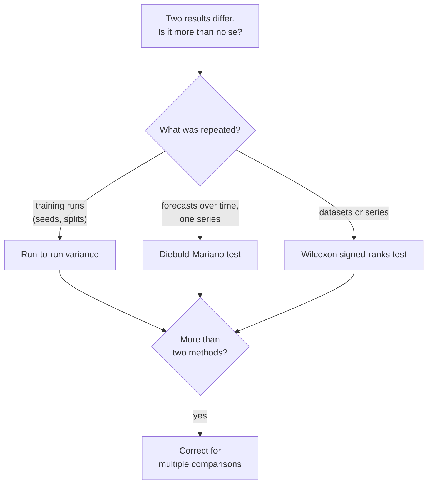

# Is the Difference Real?

A results table says that model A has an error of 0.405 and model B has 0.412. A is in bold. The table does not say what would happen with another random seed, another test period or another set of series. If the answer is "B would be in bold about half of the time", the table has shown nothing.

This page is about the size of a difference relative to its noise. Which tool applies depends on what is being compared and what can be repeated.

!!! info "How This Page Is Organized"

    As in [Evaluating Probabilistic Forecasts](timeseries-evaluation.probabilistic.md), each concept is treated in the same five steps: **the idea**, **the math**, **the picture**, **try it**, **watch out**.

    | Concept | Compares | The sample is |
    | --- | --- | --- |
    | Run-to-run variance | two training procedures | repeated runs |
    | Overlapping replicates | two learning algorithms | repeated splits of one dataset |
    | Diebold-Mariano test | two sets of forecasts | time steps |
    | The best of many | one winner against a benchmark | all the models that were tried |
    | Wilcoxon signed-ranks test | two methods | datasets |
    | Multiple comparisons | many methods | many tests at once |
    | Size and power | a claimed gain against its noise | the experiment itself, repeated in thought |

## Three Questions before Any Test

The literature on this topic grew up separately in econometrics, in machine learning and, since about 2017, in deep learning, where many of the older results were found again for random seeds. Read together, every method answers the same three questions. The arrangement below is this page's own.

1. **What was repeated?** A result is one draw, and a comparison needs repeated draws of something: time steps, forecast origins, test examples, train and test splits, training runs, datasets, or the models that were tried.
2. **How dependent are the repetitions?** Nearly every test on this page is an older test with its variance repaired for a dependence that had been ignored.
3. **What statement is wanted?** A decision to reject or not, an interval, a set of models that can not be told apart, or a probability that the difference is large enough to matter.

| What is compared | Repeated: time steps | Repeated: splits or runs | Repeated: datasets | Repeated: models tried |
| --- | --- | --- | --- | --- |
| two forecasts, as given | Diebold-Mariano[@Diebold1995-dm] | | Wilcoxon signed-ranks[@Demsar2006-sc] | |
| two forecasting methods, estimation included | conditional predictive ability[@Giacomini2003-cpa]; tests for nested models[@Clark1999-nested] | | | |
| two learning algorithms | | 5x2 cross-validation[@Dietterich1997-tests]; corrected resampled t-test[@Nadeau1999-inference] | Wilcoxon, sign test; Bayesian signed-rank test[@Benavoli2017-bayes] | |
| many models against a benchmark | | | Friedman test with corrections[@Demsar2006-sc][@Garcia2008-pairwise] | reality check[@White2000-rc]; superior predictive ability[@Hansen2005-spa] |
| many models, no benchmark | | | pairwise tests with corrections[@Benavoli2016-ranks] | model confidence set[@Hansen2011-mcs]; false discovery rate[@Benjamini1995-fdr] |

Scores are errors: lower is better.

## A Score Is a Random Variable

**The idea.** Training a deep learning model involves choices that nobody intends to matter: the random initial weights, the order of the batches, which observations ended up in the training and the test set. Change any of them and the test score changes. The reported score is one draw from a distribution, and two models can only be told apart when the gap between them is large compared with the width of those distributions.

**The math.** Bouthillier and coauthors measured these sources of variation on five deep learning tasks, randomizing one source at a time with 200 seeds each. Their findings[@Bouthillier2021-var]:

- The sampling of the data, measured with bootstrap resamples, was the largest source of variance.
- The weight initialization, the source most often varied in papers, was generally below half of the variance from data sampling, and about as large as the effect of the data order.
- For classification, the variance from data sampling matched a simple binomial model of a test set of finite size: a small test set by itself limits how small a difference can be detected.

Other studies put numbers on single sources:

| Study | What was varied | Spread found |
| --- | --- | --- |
| Reimers and Gurevych[@Reimers2017-seeds] | the seed of one published sequence tagger, 86 runs | test F1 from 89.99% to 91.00%, against a published gap of 0.27 points between two systems |
| Picard[@Picard2021-seed] | 10,000 seeds of an image classifier | standard deviation 0.2 points, 1.82 points between the worst and the best seed |
| Henderson and coauthors[@Henderson2017-matters] | ten runs of one reinforcement learning setup, split into two groups of five | the two group averages differ significantly ($p = 0.0016$) |
| Melis, Dyer and Blunsom[@Melis2017-eval] | seeds and non-deterministic arithmetic of tuned language models | about 0.4 to 0.5 perplexity; they treat a gap of 1.0 as robust |

The amount of tuning is a further source. Melis and coauthors found that standard LSTMs, tuned with the same automatic procedure as newer architectures, outperformed them[@Melis2017-eval]. Dodge and coauthors show that which of two models is better can depend on how many hyperparameter settings were tried, and propose to report the expected best validation score as a function of that budget. For $n$ random trials with scores $V_1, \cdots, V_n$ and $V_n^* = \max_i V_i$[@Dodge2019-show],

$$
P(V_n^* \le v) = P(V \le v)^n ,
$$

so the expected maximum can be computed from the empirical distribution of the scores for every $n$.

Suppose a score has standard deviation $\sigma$ from run to run. The average of $k$ runs has standard error $\sigma / \sqrt{k}$. For two methods compared on $k$ runs each, the paper gives the smallest difference of averages that a $z$-test can call at the 5% level,

$$
z_{0.05} \sqrt{\frac{\sigma_A^2 + \sigma_B^2}{k}},
$$

and notes that a smaller observed difference could be due to noise alone[@Bouthillier2021-var]. With $k = 1$, the usual single run, that threshold is $z_{0.05} \sqrt{2}\, \sigma$.

Instead of comparing averages against a threshold, the authors propose to estimate how often one method beats the other,

$$
P(A > B) = \frac{1}{k} \sum_{i=1}^{k} \mathbb 1 \{ A \text{ beats } B \text{ on pair } i \},
$$

over $k$ pairs of runs, and to call A better only when this probability is both significantly above 0.5 and above a threshold $\gamma$ that says what counts as a meaningful improvement; they report that $\gamma = 0.75$ worked well in their case studies[@Bouthillier2021-var].

**The picture.** If the two score distributions are normal with the same $\sigma$ and means that differ by $\Delta$, two formulas follow directly: a single run of A beats a single run of B with probability $\Phi\left( \Delta / (\sigma \sqrt 2) \right)$, and the method that is truly worse has the better $k$-run average with probability $\Phi\left( -\Delta \sqrt{k} / (\sigma \sqrt 2) \right)$. The widget draws both distributions, one experiment of $k$ runs per model, and the distribution of the difference of the two averages.

**Try it.** Press Play to repeat the experiment and count how often B looks better although A is the better model. Then raise the number of runs.

An interactive chart of two models whose test errors vary from run to run. Sliders set the true advantage of model A, the run-to-run spread and the number of runs per model; repeated experiments are drawn as dots on the distribution of the difference of the two averages. It needs JavaScript. In short: with a true advantage of 0.05, a spread of 0.10 and 3 runs per model, the worse model has the better average in about 27% of experiments; with 30 runs, in about 3%.

**Watch out.**

- Varying only the seed of the weight initialization understates the variance, because it leaves the larger source, the data sampling, fixed. The paper's first recommendation is to randomize as many sources of variation as possible, including data splits and the hyperparameter search[@Bouthillier2021-var].
- A fixed held-out test set hides the uncertainty from data sampling. The authors recommend resampling, with several random splits, over a single fixed test set when small improvements have to be detected[@Bouthillier2021-var].
- A threshold on the difference of averages that ignores the variance, such as "better by at least 0.5 points", does not separate real effects from chance[@Bouthillier2021-var].
- Few runs are the norm. Agarwal and coauthors found that results on a common reinforcement learning benchmark were mostly computed from 3 or 5 runs, and that reported medians moved enough between sets of runs to reverse published orderings[@Agarwal2021-precipice].
- Tests on few runs raise false alarms. Colas, Sigaud and Oudeyer took two samples of five runs that both tests they tried declared different, and the two samples came from the same algorithm[@Colas2018-seeds].
- A fixed seed gives reproducibility and no information: there is no reason to prefer one seed over another, so the comparison should be between distributions of scores[@Reimers2017-seeds].
- With enough runs, any tiny difference becomes statistically significant. Significant and meaningful are two separate questions, which is why the proposal above has two conditions; see [Size and Power](#significant-is-not-large-effect-size-and-power) below.

## Overlapping Replicates: Why the Naive Standard Error Is Too Small

**The idea.** With one dataset and no budget for many independent experiments, the usual way to get repetitions is to split the data several times: ten random train and test splits, or ten folds. The ten results look like ten measurements. They are not ten independent measurements, because the training sets share most of their data, and the test sets are drawn from the same pool. A standard error computed as if they were independent is too small, and a t-test built on it finds differences that are not there.

**The math.** Nadeau and Bengio work with $J$ random splits into $n_1$ training and $n_2$ test examples. If each split result has variance $\sigma^2$ and any two of them have correlation $\rho$, the variance of their mean is[@Nadeau1999-inference]

$$
\operatorname{Var}(\hat\mu) = \sigma^2 \left( \rho + \frac{1 - \rho}{J} \right),
$$

which does not go to zero as $J$ grows: it levels off at $\sigma^2 \rho$. The sample variance $S^2$ of the split results underestimates $\sigma^2$ at the same time, and the two effects together call for the factor $\frac{1}{J} + \frac{\rho}{1 - \rho}$ in place of $\frac{1}{J}$. Since $\rho$ is hard to estimate, they use the share of data held out as a stand-in, $\rho_0 = \frac{n_2}{n_1 + n_2}$, which gives the corrected resampled t-test. For the differences $x_j$ between two algorithms over $n$ runs[@Bouckaert2004-replic],

$$
t = \frac{ \frac{1}{n} \sum_{j=1}^{n} x_j }{ \sqrt{ \left( \frac{1}{n} + \frac{n_2}{n_1} \right) \hat\sigma^2 } },
$$

with $n - 1$ degrees of freedom.

The same repair appears wherever replicates share something:

| Replicates | What they share | Finding |
| --- | --- | --- |
| cross-validation folds | most of the training data | the 10-fold paired t-test rejects up to twice as often as it should; a t-test on repeated random splits should never be used[@Dietterich1997-tests] |
| any K-fold cross-validation | the same dataset | no unbiased estimator of its variance exists[@Bengio2004-novar]; the usual intervals miss two to three times more often than stated[@Bates2021-cv] |
| loss differentials over time | serial correlation | the long-run variance in the Diebold-Mariano test of the next section |
| test questions about one passage | the passage | standard errors that account for the clusters can be several times the naive ones[@Miller2024-errorbars] |

**The picture.** The widget compares two algorithms of exactly equal quality on $J$ random splits, thousands of times, and counts how often each test declares a difference. A sound test at the 5% level should do so 5% of the time.

**Try it.** Press Play to increase the number of splits. Then change the share of the data that is held out.

An interactive chart of the false alarm rate of two t-tests applied to the results of J random train and test splits, when the two algorithms compared are equally good. One line is the ordinary t-test, the other the corrected resampled t-test of Nadeau and Bengio. Sliders set the share of the data used for testing and the number of splits. It needs JavaScript. In short: the ordinary test declares a difference far more often than 5%, and more often the more splits are used; the corrected test stays near 5%.

**Watch out.**

- More splits do not add data. They make the ordinary test more confident about the same sample, which is why its false alarm rate grows with the number of splits.
- The correction uses a stand-in for an unknown correlation and can be off in either direction[@Nadeau1999-inference].
- Replicability is a criterion of its own. Bouckaert and Frank repeated each test ten times on the same data with different random partitions and counted how often the verdict was the same every time. In the worst case this happened on 17% of datasets for 5x2 cross-validation and on 77% for the corrected test on ten times ten-fold cross-validation[@Bouckaert2004-replic].
- Dietterich's alternative, five repetitions of two-fold cross-validation, keeps its error rate and was later found to have little power[@Dietterich1997-tests][@Nadeau1999-inference].
- These tests compare algorithms on training sets smaller than the full dataset, and a single held-out test set does not capture the variation from the choice of training set at all[@Dietterich1997-tests].
- For a time series, the repetitions are forecast origins. A rolling origin gives several test periods from one series, and they overlap in the same way[@Hewamalage2022-sc][@Cerqueira2019-vt].

## Two Forecasts on One Series: The Diebold-Mariano Test

**The idea.** In forecasting, the natural repetition is time: two forecasters each produce a forecast for every time step of a test period. At each step one of them loses less than the other. If the two are equally good, these loss differences scatter around zero. The Diebold-Mariano test asks whether their average is further from zero than chance allows. The complication is that forecast errors at neighbouring time steps are correlated, so there is less independent information in the test period than its length suggests.

**The math.** Let $e_{1t}$ and $e_{2t}$ be the errors of the two forecasts at time $t$, and $g$ a loss function, for example $g(e) = e^2$ or $g(e) = \lvert e \rvert$. The loss differential is

$$
d_t = g(e_{1t}) - g(e_{2t}), \qquad \bar d = \frac{1}{T} \sum_{t=1}^{T} d_t.
$$

The null hypothesis is equal expected loss, $\mathbb E\, d_t = 0$. Diebold and Mariano show that, when $d_t$ is covariance stationary, the statistic[@Diebold1995-dm]

$$
\operatorname{DM} = \frac{\bar d}{\sqrt{\widehat{V} / T}}
$$

is asymptotically standard normal under the null, where $\widehat V$ estimates the long-run variance of $d_t$. With independent $d_t$, $\widehat V$ would be the sample variance $\hat\gamma_d(0)$. With serial correlation the autocovariances enter,

$$
\widehat V = \hat\gamma_d(0) + 2 \sum_{\tau = 1}^{h - 1} \hat\gamma_d(\tau), \qquad
\hat\gamma_d(\tau) = \frac{1}{T} \sum_{t = \tau + 1}^{T} (d_t - \bar d)(d_{t - \tau} - \bar d).
$$

The number of autocovariances comes from the forecasting problem: the errors of optimal $h$-step-ahead forecasts are correlated up to lag $h - 1$ and not beyond, and the authors take this as the benchmark[@Diebold1995-dm]. This is the uniform lag window of the paper, written out. The test rejects equal accuracy at the 5% level when $\lvert \operatorname{DM} \rvert > 1.96$.

Diebold later summarized the test as "simply an asymptotic z-test of the hypothesis that the mean of an observed series (the loss differential) is zero", with a standard error that is robust to serial correlation[@Diebold2012-dm].

**The picture.** The widget plots a loss differential series for forecasts at horizon $h$: a bar above zero is a time step where forecast 1 lost more. The thick line is $\bar d$. Longer horizons give longer runs of bars on the same side, which is the serial correlation the standard error has to account for.

**Try it.** Keep the true mean difference at 0, set the horizon to 4 or more, and press "Repeat 2000 times". Both tests are run on 2000 fresh samples, and the bars show how often each one declares a difference that does not exist.

An interactive chart of a simulated loss differential between two forecasts over time, with its mean, the Diebold-Mariano statistic and a z statistic that ignores serial correlation. Sliders set the true mean difference, the forecast horizon and the number of forecasts. A button repeats the experiment 2000 times and shows how often each test rejects. It needs JavaScript. In short: with no true difference and a horizon of 4, the test that ignores serial correlation rejects in roughly a third of the samples and not in 5%, while the Diebold-Mariano test stays much closer to 5%.

**Watch out.**

- The test compares forecasts, not models. Its only assumption is on the loss differential, which makes it usable for forecasts from any source, including forecasts with no model behind them. Diebold warns that using it to select between models estimated on the same data is a different problem with different answers[@Diebold2012-dm].
- The assumption is that the loss differential is covariance stationary. Diebold suggests checking it the direct way: plot the loss differential and look at its autocorrelations[@Diebold2012-dm].
- With the uniform window, $\widehat V$ can come out negative. Diebold and Mariano treat that case as a rejection, and mention a Bartlett window as the alternative when a nonnegative estimate is required[@Diebold1995-dm].
- Nested models need other critical values. When one model contains the other, the two forecast errors coincide under the null hypothesis, the variance in the denominator degenerates, and the statistic compared with normal critical values rejects too rarely; Clark and McCracken derive the appropriate distributions[@Clark1999-nested].
- There are two different null hypotheses about models. One asks whether two models would be equally accurate with their parameters known exactly; the other asks whether two forecasting methods, with the estimation they involve, are equally accurate at the sample size at hand. For nested models the two can give opposite answers[@Clark2011-advances]. Giacomini and White test the second, and condition on the information available at the forecast origin: under their null, the forecaster can not predict which of the two methods will be more accurate next[@Giacomini2003-cpa].
- A small-sample modification of the statistic by Harvey, Leybourne and Newbold is treated as standard practice in the econometric literature[@Clark2011-advances][@Hansen2005-spa]. Its formula is not given here because that paper could not be opened for this page.
- The normal distribution is a large-sample result. For short test periods Diebold and Mariano turn to exact tests on the same loss differentials: the sign test and the Wilcoxon signed-rank test[@Diebold1995-dm]. The second is the subject of the next section.

## The Best of Many: Searching Inflates the Winner

**The idea.** Try twenty models that are all exactly as good as the benchmark. Each one's measured advantage is noise around zero, and the largest of twenty noisy numbers is reliably positive. Reported alone, the winner looks like an improvement. White calls this data snooping: a given set of data is used more than once for inference or model selection, so that a good result may simply be due to chance. For time series he calls it practically unavoidable, because there is only one history[@White2000-rc]. The same mechanism operates over hyperparameter settings, over random seeds, and over the research groups of a field.

**The math.** Let $f_k$ be the performance of model $k$ relative to the benchmark, with mean $\bar f_k$ over $n$ test periods, for $k = 1, \cdots, l$. White tests the hypothesis that even the best model has no advantage[@White2000-rc],

$$
H_0 : \max_{k = 1, \cdots, l} \mathbb E (f_k) \le 0, \qquad \bar V_l = \max_{k = 1, \cdots, l} \sqrt{n} \, \bar f_k ,
$$

and obtains the distribution of the statistic $\bar V_l$ by resampling the test periods in blocks, with all $l$ models kept together so that their correlation is preserved. The p-value of this reality check answers the right question: how often would the best of $l$ useless models look this good?

Two refinements followed.

- Hansen's test for superior predictive ability divides each $\bar f_k$ by its standard error and stops clearly inferior models from inflating the critical value. He shows that the reality check can be manipulated by adding poor and irrelevant models to the comparison[@Hansen2005-spa].
- The model confidence set of Hansen, Lunde and Nason needs no benchmark. It removes the worst model, tests whether the remaining ones are equally good, and repeats until the test no longer rejects. What is left contains the best model with a given confidence, like a confidence interval for a parameter. Uninformative data leave many models in the set, informative data few[@Hansen2011-mcs].

**The picture.** The widget draws the test statistic of the winner over thousands of repeated searches, each over models with no true advantage. The dashed curve is what a single model chosen in advance would show.

**Try it.** Press Play to increase the number of models tried from 1 to 200. Then raise the correlation between the models.

An interactive histogram of the test statistic of the best of many models that are all no better than the benchmark, over 3,000 repeated searches, against the standard normal curve for a single model. Sliders set the number of models tried and the correlation between them. It needs JavaScript. In short: with 20 independent models the winner passes a 5% test meant for one model in about 64% of the searches; with highly correlated models the inflation is much smaller.

**Watch out.**

- Correlated models cost less. In White's example the p-value erodes slowly over long stretches of the search, because the models' forecasts are highly correlated[@White2000-rc]. Twenty variants of one architecture are not twenty independent tries.
- The search includes what is not reported. Picard argues that the thousands of papers submitted on one benchmark each year amount to a scan of the seed landscape, and that trial-and-error improvement of a model is an implicit one[@Picard2021-seed]. Demšar makes the point for whole fields: among groups trying similar ideas of equal merit, the one that publishes is the one with the most luck in its datasets and samples[@Demsar2008-appropriate].
- The winner of a hyperparameter search is the same case: the expected best of $n$ trials grows with $n$, so two models are comparable only at the same budget[@Dodge2019-show].
- Leaderboards add the adaptive version, where each new submission is shaped by earlier scores; see [Leakage and Contamination](timeseries-evaluation.leakage.md#reuse-the-test-set-wears-out).
- The model confidence set says nothing about models that were not in the candidate set[@Hansen2011-mcs].

## Many Datasets: The Wilcoxon Signed-Ranks Test

**The idea.** A method is often evaluated on many datasets, or on many series. On each one, method 2 is better or worse than method 1 by some amount. Averaging these amounts is tempting and fragile: errors on different datasets are on different scales, and one dataset with a huge difference can decide the average. The Wilcoxon signed-ranks test keeps only the order of the differences. It asks whether the large differences tend to be on one side.

**The math.** Following Demšar, let $d_i$ be the difference between the scores of the two methods on the $i$-th of $N$ datasets. Rank the differences by absolute value, with average ranks for ties, and sum the ranks on each side[@Demsar2006-sc]:

$$
R^+ = \sum_{d_i > 0} \operatorname{rank}(d_i) + \frac{1}{2} \sum_{d_i = 0} \operatorname{rank}(d_i), \qquad
R^- = \sum_{d_i < 0} \operatorname{rank}(d_i) + \frac{1}{2} \sum_{d_i = 0} \operatorname{rank}(d_i).
$$

The test statistic is $T = \min(R^+, R^-)$. If the two methods are equivalent, the ranks fall on either side at random and the two sums are similar; a small $T$ is evidence against that. For small $N$ the critical values come from a table. For larger $N$,

$$
z = \frac{T - \frac{1}{4} N (N + 1)}{\sqrt{\frac{1}{24} N (N + 1)(2N + 1)}}
$$

is approximately standard normal, and the null hypothesis is rejected at the 5% level when $z < -1.96$[@Demsar2006-sc].

Demšar recommends this test over the paired $t$-test for comparing two classifiers over multiple datasets, for three reasons: the $t$-test assumes that the differences are commensurable across datasets, it needs normally distributed differences unless there are about 30 datasets or more, and it is affected by outliers. The Wilcoxon test assumes commensurability only qualitatively: larger differences count more, but their magnitudes are ignored[@Demsar2006-sc].

**The picture.** The widget uses the worked example from Demšar's paper: the AUC of the C4.5 decision tree with and without tuning one of its parameters, on 14 datasets. The differences are sorted by absolute size, and the rank of each goes to the side of its sign. For these data $R^+ = 93$ and $R^- = 12$, so $T = 12$; the paper gives 21 as the critical value for 14 datasets at the 5% level, so the difference is significant[@Demsar2006-sc].

**Try it.** Press Play to watch the ranks being handed out. Then multiply the largest difference by 10 and compare what happens to the two statistics. Click rows to flip signs and find out how many datasets have to change sides before the result is no longer significant.

An interactive chart of the differences between two classifiers on 14 datasets, from Demšar (2006), sorted by absolute size and labelled with their ranks. The sums of ranks for positive and negative differences, the Wilcoxon statistic and the paired t statistic are shown. A slider enlarges the largest difference and clicking a row flips its sign. It needs JavaScript. In short: the rank sums are 93 and 12, which is significant at the 5% level; enlarging the largest difference changes no rank and so does not change the Wilcoxon result, while the t statistic drops because the standard deviation grows.

**Watch out.**

- The test needs enough datasets. Bouthillier and coauthors point out that machine learning papers typically use as few as 3 to 5 datasets, where this test has very little power[@Bouthillier2021-var]. With 5 datasets, even five wins out of five cannot be significant at the 5% level in a two-sided test: there are $2^5 = 32$ equally likely sign patterns under the null, so the most extreme result has probability $2/32 \approx 0.06$.
- Differences should not be rounded before ranking. Rounding creates ties, and ties cost power[@Demsar2006-sc].
- The datasets are treated as a sample of independent problems. Many series from one source, for example the stores of one retail chain, are less independent than their number suggests.
- The same data can be read without a null hypothesis. Benavoli and coauthors, among them the author of the paper this section follows, propose a Bayesian version of the signed-rank test with a region of practical equivalence: differences below 1% of accuracy count as no difference, and the analysis returns three probabilities, that one method is practically better, that the other is, and that they are equivalent[@Benavoli2017-bayes].
- Counting wins is weaker still: it ignores the size of the differences altogether. Demšar discusses it as the sign test and notes that it is weaker than the Wilcoxon test[@Demsar2006-sc].

## Many Comparisons at Once

**The idea.** A test at the 5% level raises a false alarm in one of twenty cases where there is nothing to find. Compare a new method against ten others, or seven methods against each other in all 21 pairs, and false alarms are no longer rare events. Some of the "significant" entries in a large results table are there by chance. The remedy is to make each single test stricter, so that the chance of any false alarm in the whole family of tests stays at 5%.

**The math.** The family-wise error is the probability of making at least one false rejection among all the comparisons[@Demsar2006-sc]. For $m$ independent tests at level $\alpha$ where no real difference exists, it is

$$
1 - (1 - \alpha)^m,
$$

which is 40% for $m = 10$ and 64% for $m = 20$ at $\alpha = 0.05$. Two corrections, both described by Demšar for comparing $k - 1$ methods with a control[@Demsar2006-sc]:

- **Bonferroni**: compare every p-value with $\alpha / m$, where $m$ is the number of comparisons.
- **Holm**: sort the p-values, $p_1 \le p_2 \le \cdots \le p_m$. Compare $p_1$ with $\alpha / m$; if it is below, reject and compare $p_2$ with $\alpha / (m - 1)$, and so on. Stop at the first p-value that is not below its threshold and retain all remaining hypotheses.

Holm's procedure rejects everything Bonferroni rejects and possibly more, and it makes no additional assumptions, so Demšar describes it as the more powerful of the two[@Demsar2006-sc].

A third procedure changes the target. Benjamini and Hochberg argue that with many comparisons the relevant error is the share of false discoveries among all discoveries, not the chance of a single false one. With $V$ false and $S$ true rejections, the false discovery rate is $\mathbb E\left( V / (V + S) \right)$. Their procedure sorts the p-values, finds the largest $i$ with[@Benjamini1995-fdr]

$$
p_{(i)} \le \frac{i}{m} \, q^*,
$$

and rejects the hypotheses belonging to $p_{(1)}, \cdots, p_{(i)}$. For independent tests this keeps the false discovery rate at or below $q^*$. It rejects more than the family-wise procedures, and it is the natural choice for screening many candidates when a small share of false leads is acceptable.

When all methods are compared with each other over many datasets, Demšar recommends starting with the Friedman test, which works on the ranks of the methods within each dataset, followed by a post-hoc test. In the Nemenyi test, two of $k$ methods compared on $N$ datasets differ significantly when their average ranks differ by at least the critical difference

$$
\operatorname{CD} = q_\alpha \sqrt{\frac{k (k + 1)}{6 N}},
$$

with $q_\alpha$ from a table in the paper[@Demsar2006-sc]. The same paper shows that the tests have much more power when all methods are compared with one control than when all pairs are compared, and concludes that pairwise comparisons should not be made when the question is only whether a new method is better than the existing ones.

**The picture.** Each cell of the widget is one comparison with its p-value. A filled orange cell is a false discovery: declared significant although the two methods do not differ. Outlined blue cells are comparisons with a real difference, filled when the procedure detects them.

**Try it.** With no real differences, press Play and watch how often at least one cell lights up without a correction. Then add a few real differences and compare how many of them Bonferroni and Holm still find.

An interactive grid of p-values from many comparisons made at once. Sliders set the number of comparisons and how many of them have a real difference; buttons choose no correction, the Bonferroni correction or Holm's procedure. Bars show in what share of repeated experiments at least one false discovery occurs under each procedure. It needs JavaScript. In short: with 10 comparisons and no real differences, at least one comes out significant at the 5% level in about 40% of experiments without a correction, and in about 5% with either correction.

**Watch out.**

- Corrections cost power: with many comparisons, real differences are missed more often. Fewer, planned comparisons are better than all possible ones.
- The Nemenyi test and the diagrams built on it have been challenged twice. García and Herrera advise against it because it is very conservative and misses obvious differences, and recommend procedures that use the logical relations between pairwise hypotheses[@Garcia2008-pairwise]. Benavoli, Corani and Mangili show a deeper problem: since the ranks are computed over all methods, whether A differs significantly from B depends on which other methods are in the comparison. They recommend pairwise Wilcoxon or sign tests with a correction instead[@Benavoli2016-ranks].
- With very many series the critical difference becomes so small that negligible differences are significant[@Hewamalage2022-sc].
- "A is significantly better than the baseline, and B is not" does not show that A is better than B. Gelman and Stern's example: two estimates of 25 and 10, each with standard error 10. The first is clearly significant and the second is not, while their difference, 15 with a standard error of 14, is far from significant[@Gelman2006-difference].
- The comparisons that were tried and not reported count as well. A hyperparameter search that evaluates a hundred configurations on the test set and reports the best is a multiple comparison without a correction.
- Bouthillier and coauthors note the limit of the approach for leaderboards: with hundreds of entries, corrections become so strict that the choice of a winner is necessarily somewhat arbitrary, and a different test set might have given a different ranking[@Bouthillier2021-var].

## Significant Is Not Large: Effect Size and Power

**The idea.** A significance test answers one question: could noise alone have produced this difference? It does not say how large the difference is or whether it matters. With enough data any difference, however small, becomes significant. With too little data a real difference goes unnoticed, and there is a less obvious consequence: the experiments that do reach significance are the ones where noise happened to push the estimate up, so they overstate the effect. A field that publishes only significant results from small experiments publishes exaggerations.

**The math.** The power of a test is the probability that it rejects when a real effect of a given size exists. For an estimate $\hat d$ with standard error $s$ and true value $d$, tested two-sided at the 5% level,

$$
\text{power} = P\left( \lvert \hat d \rvert > 1.96 \, s \right) = 1 - \Phi\left( 1.96 - \frac{d}{s} \right) + \Phi\left( -1.96 - \frac{d}{s} \right) .
$$

Gelman and Carlin add two quantities for the experiments that come out significant: the probability that the estimate has the wrong sign, and the exaggeration ratio, the expected size of a significant estimate divided by the true effect[@Gelman2014-typesm],

$$
\text{exaggeration} = \frac{ \mathbb E \left( \lvert \hat d \rvert \; \middle\vert \; \lvert \hat d \rvert > 1.96 \, s \right) }{ d } .
$$

At 80% power, when the true effect is 2.8 standard errors, the ratio is 1.12 and wrong signs practically do not occur. At low power both get worse quickly.

How much power do typical evaluations have?

- Card and coauthors estimated the smallest accuracy difference that the test sets of a language benchmark can detect with 80% power. For a test set of 1,725 examples it was 1.6 points, while the mean improvement reported on it was 0.6 points[@Card2020-power].
- Miller derives the sample size for comparing two language models on the same questions and arrives at about 1,000 questions to detect a difference of 3 points with 80% power in his example[@Miller2024-errorbars].
- Estimates of the needed number of runs from a small pilot are too optimistic, because standard deviations estimated from few runs are too small on average[@Colas2018-seeds].

**The picture.** The widget shows the distribution of the estimated difference over repeated experiments. Its unit is the standard error, so one slider covers every case. The shaded tails are the experiments that reach significance.

**Try it.** Press Play to shrink the true difference from 4 standard errors to almost none, and watch the average significant estimate stay far out while the truth moves towards zero.

An interactive chart of the sampling distribution of an estimated difference, in units of its standard error, with the regions shaded where the estimate is significant at the 5% level. A slider sets the true difference. The power, the average size of the significant estimates relative to the truth, and the share of significant estimates with the wrong sign are shown. It needs JavaScript. In short: with a true difference of 2.8 standard errors the power is 80% and significant estimates overstate the effect by a factor of about 1.1; with a true difference of 1 standard error the power is 17% and significant estimates are about 2.5 times too large.

**Watch out.**

- The statement of the American Statistical Association on p-values lists what a p-value is not: it is not the probability that the hypothesis is true, and it does not measure the size or the importance of an effect; any effect, however small, can produce a small p-value if the sample is large enough[@Wasserstein2016-asa].
- A significant result does not show that the experiment had high power[@Card2020-power].
- The effect size for a power calculation has to come from outside the experiment, not from its own noisy estimate[@Gelman2014-typesm].
- A non-significant difference is not evidence of equality. To claim that two methods are practically the same, an interval has to lie inside a stated region of equivalence[@Benavoli2017-bayes].
- The statement also asks researchers to disclose every hypothesis explored and every analysis run, since reporting only the ones that passed a threshold makes the reported p-values uninterpretable[@Wasserstein2016-asa].

## Beyond a Single Winner: Intervals, Sets and Curves

Several papers replace the question "who wins?" by a statement that shows how much of the ordering the data can support.

| Report | What it shows | Source |
| --- | --- | --- |
| interval for an aggregate score | resample runs within each task, recompute the aggregate, repeat | Agarwal and coauthors[@Agarwal2021-precipice] |
| interquartile mean | the mean of the middle half of all runs: less noisy than the median, less outlier-driven than the mean | Agarwal and coauthors[@Agarwal2021-precipice] |
| performance profile | for every threshold, the share of problems or runs on which a method is within that threshold | Dolan and Moré[@Dolan2002-profiles]; with uncertainty bands[@Agarwal2021-precipice] |
| probability of improvement | how often one method beats the other | Bouthillier and coauthors[@Bouthillier2021-var] |
| almost stochastic dominance | how far the whole distribution of one model's scores lies above the other's | Dror, Shlomov and Reichart[@Dror2019-dominance] |
| model confidence set | the models that can not be distinguished from the best | Hansen, Lunde and Nason[@Hansen2011-mcs] |
| expected best score by budget | performance as a function of the number of tuning trials | Dodge and coauthors[@Dodge2019-show] |

Dolan and Moré give the reasons that also apply to forecasting benchmarks: averages are dominated by a few hard problems, ranks lose the size of the differences, and medians hide what happens between the quartiles[@Dolan2002-profiles].

## Where the Literature Disagrees

| Question | One position | The other |
| --- | --- | --- |
| Friedman test with Nemenyi post-hoc? | recommended for many methods on many datasets[@Demsar2006-sc] | too conservative[@Garcia2008-pairwise]; the verdict on two methods depends on the others in the pool[@Benavoli2016-ranks] |
| Keep null hypothesis tests? | yes, used properly and with power reported[@Dror2018-hitchhiker][@Card2020-power][@Wasserstein2016-asa] | abandon them for Bayesian analysis with a region of equivalence[@Benavoli2017-bayes]; they promote lucky results[@Demsar2008-appropriate] |
| 5x2 cross-validation? | recommended: it keeps its error rate[@Dietterich1997-tests] | too little power and poor replicability; use the corrected resampled test[@Nadeau1999-inference][@Bouckaert2004-replic] |
| Bootstrap intervals from few runs? | yes, pooled over tasks[@Agarwal2021-precipice] | about twice the stated false alarm rate with five runs; prefer Welch's t-test[@Colas2018-seeds] |
| Which null hypothesis for forecasting models? | equal accuracy of the models at their true parameters | equal accuracy of the methods as estimated, given the information at the forecast origin[@Giacomini2003-cpa]; they answer different questions[@Clark2011-advances] |
| Does reusing a test set overfit it in practice? | it can, badly, in theory | little found in large audits; see [Leakage and Contamination](timeseries-evaluation.leakage.md#reuse-the-test-set-wears-out) |

The deep learning papers of 2017 to 2021 arrived, for random seeds, at what Dietterich and Nadeau and Bengio had established twenty years earlier for data splits: the replicates are fewer and less independent than they look.

## In Practice

1. Decide what the unit of repetition is: runs, time steps or datasets. That decides the tool.
2. Report a measure of spread next to every score: the standard deviation over runs, or a confidence interval.
3. Randomize more than the weight initialization when the budget allows it: data splits first.
4. For two forecasters on one test period, look at the loss differential over time before testing it.
5. For many datasets, compare with ranks, and say how many datasets there were.
6. Count the comparisons that were made, including the ones left out of the table.
7. Report the size of the difference, not only whether it is significant, with a [baseline](timeseries-evaluation.baselines.md) for scale.
8. Before trusting a standard error, ask what the repetitions share: training data, a test period, a seed, a common shock.
9. When the best of several models is reported, say how many were tried, and compare the winner with the best of that many, not with one.
10. Say what difference would matter, and how large a difference the experiment could have detected.
